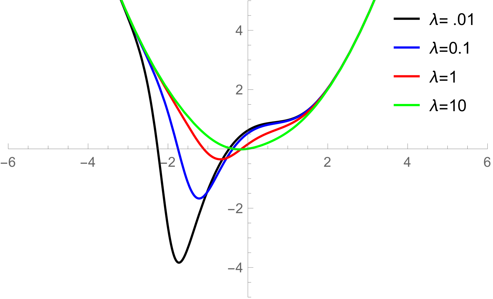
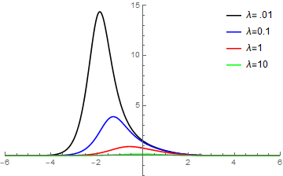
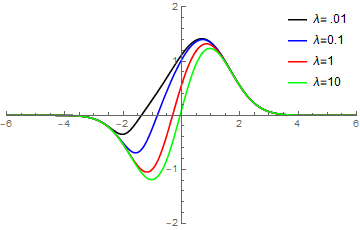

**arXiv:2506.04643v1 [hep-th]**

> **引用体例说明**：每一句总结后面紧跟对应的**原文英文摘录**（引号内为 arXiv 原文，未改写），并在括号中标出处（章 / 式号 / 图号 / 引用键）。
>
> **原文来源**：<https://arxiv.org/abs/2506.04643> ｜ 全文（LaTeXML）：<https://arxiv.org/html/2506.04643v1> ｜ 本目录 PDF：[`2506.04643v1.pdf`](/notes/文章整理/FP方程与热势/arXiv-2506.04643v1/2506.04643v1.pdf)、HTML：`2506.04643v1.html`
>
> **本目录性质**：`FP方程与热势/` 是用户为一项独立计算单开的主题目录（2026-11-08）。本笔记只讨论本篇文献。
>
> **本篇引用的同目录文献**：参考文献 **[40]** = `arXiv-2111.05856v1/`（Xu, PRD 104 (2021) 104022）。这是原文自己写明的引用关系。

---

## 一、元信息

| 项 | 内容 | 出处 |
| --- | --- | --- |
| 标题 | Analysis of the Fokker-Planck Equation in Schwarzschild Spacetime: A Supersymmetric Connection | arXiv 标题 |
| 作者 | Ojaswini Sharma、Aradhya Shukla | > "Ojaswini Sharma and Aradhya Shukla" |
| 单位 | GLA University, Mathura, Uttar Pradesh, India | > "Department of Physics, Institute of Applied Sciences and Humanities, GLA University, Mathura- 281406, Uttar Pradesh, India" |
| 分类 | hep-th；quant-ph | arXiv 记录 |
| 篇幅 | 10 页，3 幅子图（Figure 1 的 (a)(b)(c)） | > "10 Pages, 3 Figures" |
| 投稿 | 2025-06-05（仅 v1） | > "Submitted on 5 Jun 2025" |
| 许可 | CC BY 4.0 | arXiv 记录 |

---

## 二、摘要要点

1. **做了什么**：用 Fokker–Planck 方程重新分析 Schwarzschild 时空中的热势动力学。
   > "We have re-analyzed the dynamics of the thermal potential within Schwarzschild spacetime by employing the Fokker-Planck equation."

2. **核心结果 1**：FP 方程化归为一个**带谐振子势的、被缩放的量子力学问题**。
   > "We demonstrate that the Fokker-Planck equation reduces to a simplified form equivalent to a scaled quantum mechanical problem with a harmonic oscillator potential."

3. **核心结果 2**：建立 SUSY QM 与 Schwarzschild 的 FP 动力学之间的对应。
   > "we highlight an interesting correspondence between supersymmetric quantum mechanics (SUSY QM) and the Fokker-Planck dynamics associated with the Schwarzschild metric."

4. **核心结果 3**：借助 SUSY QM 的**等谱形变**（isospectral deformation），得到一族**单参数**等谱势；谱与原谐振子相同，波函数不同。
   > "Utilizing the isospectral deformation, an intrinsic feature of SUSY QM, we derive a family of one-parameter isospectral potentials. Notably, this new class of potentials exhibits the same energy spectrum as the original harmonic oscillator potential, but with distinct wavefunctions."

---

## 三、第 1 节（引言）要点

5. **SUSY 的起源与其在 QM 中的版本**：场论中的 SUSY 把玻色子与费米子配对；仿此发展出量子力学版本的 SUSY。
   > "Drawing inspiration from field-theoretic SUSY, a quantum-mechanical version of SUSY has been developed [6, 7]. In SUSY quantum mechanics (QM), there are two different potentials known as supersymmetric partners, which share identical energy spectra [8, 9]."

6. **破缺判据（本文采用的说法）**：两个伙伴势**共享基态**时 SUSY 未破缺，**基态不同**时破缺。
   > "SUSY is said to be unbroken when both partner potentials have a common ground state [10], and it is considered broken if the two potentials possess different ground states [11]."

7. **SUSY QM 的两大工具**：形状不变性（shape invariance）与等谱形变（isospectral deformation）。
   > "SUSY QM offers many intriguing features, such as shape invariance [15, 16, 17] and isospectral deformation [7]."

8. **等谱形变的两种做法**：超势的**平移**（translation）与**缩放**（scaling）；本文用前者。
   > "The process of deformation of the potential can be done by two different methods; translation [11] and scaling of the superpotential [21]."

9. **本文的直接出发点**：文献 [40]（= `arXiv-2111.05856v1`）已证明在 FP 框架下 Schwarzschild 黑洞的热势等价于一个量子谐振子，能级正比于系综温度；本文在其上叠加 SUSY 等谱形变，得到"同谱异波函数"的新势。
   > "Recently, it has been demonstrated that within the FP framework [40], the thermal potential of a Schwarzschild black hole is equivalent to a quantum mechanical oscillator, with discrete energy levels proportional to the temperature of the ensemble. By applying the formalism of SUSY quantum mechanics, we derived a new potential that has the same energy spectra but different wavefunctions [41]."

10. **文章结构**：第 2 节 FP 方程，第 3 节 SUSY QM 与等谱形变，第 4 节两者对接，第 5 节结论。
    > "In Section 2, we provide a brief discussion on the FP equation for the Schwarzschild metric. The basic formalism of SUSY QM and isospectral deformation is outlined in Section 3 for completeness. Section 4 is dedicated to establishing the connection between SUSY QM and the FP equation, and generating a new one parameter isospectral potential. Finally, we conclude in Section 5."

---

## 四、第 2 节：Schwarzschild 时空与 FP 方程（式 (1)–(7)）

### 4.1 FP 方程与 Hermitian 化

11. **方程形式**（常数扩散系数 $D$、与时间无关的漂移系数 $\mu(x)$）：

    $$
    \frac{\partial P}{\partial t}=\Big[\frac{\partial}{\partial x}f'(x)+D\frac{\partial^{2}}{\partial x^{2}}\Big]P(x,t)=L_{\rm FP}P(x,t)=-\frac{\partial S(x,t)}{\partial x}\qquad\text{(式 (1))}
    $$

    其中 $f(x)=-\int^{x}\mu(y)\,\mathrm{d}y$，$S(x,t)$ 是概率流。
    > "here, $f(x)=-\int^{x}\mu(y)\,dy$ represents the potential term with $f^{\prime}(x)=\frac{df(x)}{dx}$ and $S(x,t)$ denotes the probability current."

12. **本征值方程**：取 $P(x,t)=\Phi(x)e^{Et}$，得

    $$
    L_{\rm FP}\Phi(x)=-E\,\Phi(x)\qquad\text{(式 (2))}
    $$

    > "By assuming an ansatz for the probability density, $P(x,t)=\Phi(x)e^{E\,t}$ and applying the relevant boundary conditions, the FP eqn. is transformed into an eigenvalue equation $L_{FP}\,\Phi(x)=-E\,\Phi(x)$."

13. **化为 Schrödinger 型**：令 $\eta(x)=f(x)/D$、$\Psi=e^{\eta/2}\Phi$，则 $L\Psi=E\Psi$，

    $$
    L=-D\frac{\partial^{2}}{\partial x^{2}}+V(x),\qquad V(x)=\frac{1}{4D}[f'(x)]^{2}-\frac{1}{2}f''(x)\qquad\text{(式 (3))}
    $$

    > "By scaling the potential function with the diffusion coefficient, $\eta(x)=f(x)/D$, Eq. (2) transforms into the eigenvalue equation $L\Psi(x)=E\Psi(x)$ where, $\Psi(x)=e^{\eta(x)/2}\Phi(x)$ and operator $L$ is then given by ... having the similar form of Hamiltonian operator in Schrödinger equation."

### 4.2 热势与有效势

14. **度规**（$m$ 为 ADM 质量）：

    $$
    \mathrm{d}s^{2}=-\Big(1-\frac{2m}{r}\Big)\mathrm{d}t^{2}+\frac{\mathrm{d}r^{2}}{1-2m/r}+r^{2}\mathrm{d}\Omega^{2}\qquad\text{(式 (4))}
    $$

15. **热势**（$r_h$ 为事件视界，$T$ 为系综温度）：

    $$
    U=\tfrac12 r_h-\pi T r_h^{2}
    $$

    > "Thermal potential for this black hole can be calculated as: $U=\frac{1}{2}r_{h}-\pi Tr^{2}_{h}$ with event horizon ($r_h$) and is the ensemble temperature ($T$)."

16. **极值条件**：$U$ 在 $T=T_h$ 处取**极大**。
    > "It is to be noted that the thermal potential reaches its maximum value at $T=T_{h}$."

17. **代入 FP 的形式**：取 $f(x)=\tfrac12 x-\pi T x^{2}$，得有效势

    $$
    V(x)=\big(\pi^{2}T^{2}D\big)y^{2}+\pi T,\qquad y=x-\frac{1}{4\pi T}\qquad\text{(式 (5))}
    $$

    > "the potential is considered as $f(x)=\frac{1}{2}x-\pi Tx^{2}$, yielding the effective potential as $V(x)=(\pi^{2}T^{2}D)y^{2}+\pi T,\ y=x-(1/4\pi T)$."

### 4.3 谱与波函数

18. **约化方程**：令 $\zeta=\sqrt{\pi T/D}\,y$，

    $$
    \pi T\Big[-\frac{\partial^{2}}{\partial \zeta^{2}}+\big(1+\zeta^{2}\big)\Big]\Psi=E\,\Psi\qquad\text{(式 (6))}
    $$

    > "one can easily get the FP eqn. in the simplest form as $\pi T[-\partial^2/\partial\zeta^2+(1+\zeta^2)]\Psi(x)=E\Psi(x)$, where $\zeta=\sqrt{\pi T/D}\,y$ is an auxiliary variable."

19. **谱与波函数**：

    $$
    E_n=2\pi T(n+1),\qquad \Psi_n(x)=\Big(\frac{T}{D}\Big)^{1/4}\frac{1}{\sqrt{2^{n}n!}}H_n(\zeta)e^{-\zeta^{2}/2},\quad n=0,1,2,\dots\qquad\text{(式 (7))}
    $$

    > "From the above equation, one can get the energy eigenvalue and eigenfunction as $E_{n}=2\pi T(n+1)$, $\Psi_{n}(x)=(T/D)^{1/4}\frac{1}{\sqrt{2^{n}n!}}H_{n}(\zeta)e^{-\zeta^{2}/2}$."

### 4.4 代数复核（我的计算，非原文）

- **式 (5) 自洽**：$f'=\tfrac12-2\pi Tx=-2\pi Ty$，故 $\frac{(f')^2}{4D}=\frac{\pi^2T^2}{D}y^2$，而 $-\tfrac12f''=\pi T$，合于 (5)。
- **式 (6) 自洽**：$\partial_x=\sqrt{\pi T/D}\,\partial_\zeta$ ⇒ $-D\partial_x^2=-\pi T\partial_\zeta^2$，$V=\pi T(\zeta^2+1)$，合于 (6)。
- **式 (7) 自洽**：由 $-\Psi''+\zeta^2\Psi=(2n+1)\Psi$ 得 $E=\pi T(2n+2)=2\pi T(n+1)$；基态 $E_0=2\pi T\neq0$，与 [40]（`arXiv-2111.05856v1` **§III.1** "Application 1: Schwarzschild black hole"）"Schwarzschild 谱正比于 $T$、基态非零"一致。
- **波函数归一化也对**（此处我最初以为漏了 $\pi^{1/4}$，复核后确认原文正确）：以 $\zeta$ 变量的标准归一化 $\psi^{(\zeta)}_n=\pi^{-1/4}(2^nn!)^{-1/2}H_ne^{-\zeta^2/2}$ 出发，由 $\mathrm{d}x=\sqrt{D/(\pi T)}\,\mathrm{d}\zeta$ 得

  $$
  \Psi_n=\Big(\frac{\pi T}{D}\Big)^{1/4}\pi^{-1/4}\frac{H_ne^{-\zeta^2/2}}{\sqrt{2^nn!}}=\Big(\frac{T}{D}\Big)^{1/4}\frac{H_ne^{-\zeta^2/2}}{\sqrt{2^nn!}},
  $$

  与式 (7) 完全一致。
- **符号不一致**：式 (2) 写作 $L_{\rm FP}\Phi=-E\Phi$，式 (3) 之后写作 $L\Psi=E\Psi$；$L=-D\partial_x^2+V$ 的谱为正（$E_n=2\pi T(n+1)>0$），故应以 (3) 之后那一形式为准，(2) 的负号应去掉。

---

## 五、第 3 节：SUSY QM 与等谱形变（式 (8)–(16)）

20. **Hamiltonian 与超荷**：

    $$
    H=-\frac{\mathrm{d}^2}{\mathrm{d}x^2}+V\quad\text{(式 (8))}
    $$

    $$
    H_+=A^{+}A,\qquad H_-=AA^{+}\quad\text{(式 (9))}
    $$

    $$
    A=\frac{\mathrm{d}}{\mathrm{d}x}+W(x),\qquad A^{\dagger}=-\frac{\mathrm{d}}{\mathrm{d}x}+W(x)\quad\text{(式 (10))}
    $$

21. **伙伴势**：

    $$
    V_+=W^{2}+W',\qquad V_-=W^{2}-W'\qquad\text{(式 (11)–(13))}
    $$

    > "It is to be noted that $V_{+}$ and $V_{-}$ have the same energy eigenvalue with common ground state."

22. **等谱形变（平移超势）**：

    $$
    W_1(x)=W(x)+f(x)\quad\text{(式 (14))}
    $$

    代入 (13) 得 **Bernoulli 方程**：

    $$
    f^{2}+2Wf+\frac{\mathrm{d}f}{\mathrm{d}x}=0\quad\text{(式 (15))}
    $$

    其解为

    $$
    f(x)=\frac{e^{-\int 2W(x)\mathrm{d}x}}{\lambda_1-\int e^{-\int 2W(x)\mathrm{d}x}\mathrm{d}x}\quad\text{(式 (16))}
    $$

23. **原文的结论性说法**："在该条件下 $V_-$ 保持不变，而生成新的 $V_+$"。
    > "Under this condition $V_{-}$ remains intact and a new form of potential $V_{+}$ is generated."

### 5.1 代数复核（我的计算，非原文）

- **式 (9) 与 (11)(12) 的标签互换**：按 (10) 的 $A=\partial_x+W$、$A^\dagger=-\partial_x+W$，有

  $$
  A^\dagger A=-\partial_x^2+W^2-W',\qquad AA^\dagger=-\partial_x^2+W^2+W',
  $$

  而原文 (11) 把 $H_+$ 写成 $W^2+W'$ —— 与 (9) 相反。属**标记互换**，不影响 (13) 之后的推导，但会让"哪个势被保持"读起来自相矛盾。
- **式 (15) 的真实含义**：把 $W\to W+f$ 代入 $V_\pm=W^2\pm W'$：

  $$
  V_+\to V_++\big(2Wf+f^2+f'\big),\qquad V_-\to V_-+\big(2Wf+f^2-f'\big).
  $$

  所以 Bernoulli 条件 $f^2+2Wf+f'=0$ 恰好**保持 $V_+$ 不变**、而把 $V_-$ 变成 $V_- -2f'$。这与第 23 条原文所说"$V_-$ 保持不变、$V_+$ 被改变"**正好相反**。

---

## 六、第 4 节：FP 与等谱形变的对接（式 (17)–(25)、图 1）

24. **起点**：仍为式 (17)（与式 (6) 相同），有效势 $V=1+\zeta^{2}$ 是缩放后的谐振子。（(6)(17) 怎么来的、每步代数与 $D$ 位置的问题见 **Q2**。）
    > "The FP equation for the Schwarzschild spacetime reduces to the Schrodinger equation as $\pi T[-\partial_\zeta^2+(1+\zeta^2)]\Psi(x)=E\Psi(x)$ (17)."

25. **超势取** $W(\zeta)=\zeta$（因为 $W^2+W'=\zeta^2+1$ 正是该有效势）。
    > "The superpotential corresponding to the potential in eqn. (17): $W(\zeta)=\zeta$."

26. **形变函数**（Bernoulli 方程的解）：

    $$
    f(\zeta)=\frac{2e^{-\zeta^{2}}}{\sqrt{\pi}\,\big(\mathrm{erf}(\zeta)+\lambda\big)}\qquad\text{(式 (19))}
    $$

    新超势：

    $$
    \tilde W(\zeta)=\zeta+\frac{2e^{-\zeta^{2}}}{\sqrt{\pi}\big(\mathrm{erf}(\zeta)+\lambda\big)}\qquad\text{(式 (20))}
    $$

27. **原文给出的形变势**：

    $$
    \tilde V_+=1+\zeta^{2}+\frac{2e^{-\zeta^{2}}}{\sqrt{\pi}\big(\mathrm{erf}(\zeta)+1+\lambda\big)}\Bigg[\frac{e^{-\zeta^{2}}}{\sqrt{\pi}\big(\mathrm{erf}(\zeta)+1+\lambda\big)}+2\zeta\Bigg]\qquad\text{(式 (21))}
    $$

    > "The above superpotential has different functional form but it keeps the original potential $\tilde V_-=V_-$ intact. However, exploiting the eqns. (17), (18) and (20) one will get a deformed potential $\tilde V_+$, as following (21)."

28. **基态与第一激发态**：

    $$
    \tilde\psi^{(0)}_1(\zeta)\propto\frac{2e^{-\zeta^{2}/2}}{\mathrm{erf}(\zeta)+1+\lambda}\qquad\text{(式 (22))}
    $$

    $$
    \tilde\psi^{(1)}_1\propto 2\zeta e^{\zeta^{2}/2}+\sqrt{\frac{1}{\pi}}\,\frac{2e^{-3\zeta^{2}/2}}{\mathrm{erf}(\zeta)+1+\lambda}\qquad\text{(式 (23))}
    $$

29. **产生算符与第 $n$ 激发态**：

    $$
    \tilde A^{\dagger}=\zeta-\sqrt{\frac1\pi}\,\frac{-2e^{\zeta^{2}}}{\mathrm{erf}(\zeta)+1+\lambda}+\frac{\mathrm{d}}{\mathrm{d}\zeta}\qquad\text{(式 (24))}
    $$

    $$
    \tilde\psi^{(n)}_1\propto\Big[\zeta+\sqrt{\tfrac1\pi}\,\frac{2e^{-\zeta^{2}}}{\mathrm{erf}(\zeta)+1+\lambda}-\frac{\mathrm{d}}{\mathrm{d}\zeta}\Big]\Big[\zeta+\frac{\mathrm{d}}{\mathrm{d}\zeta}\Big]\Big[-\zeta+\frac{\mathrm{d}}{\mathrm{d}x}\Big]^{n}e^{-\zeta^{2}/2}\quad\text{（式 (24) 之后的无编号式）}
    $$

30. **图的说明（原文 Figure 1）**：等谱势在原点附近强烈依赖 $\lambda$；$\lambda$ 小时彼此差别明显，$\lambda$ 大时趋于共同的渐近形式；波函数在 $x=0$ 附近的幅度与曲率随 $\lambda$ 变化，但都平方可积。
    > "As depicted in Figure, the isospectral potentials strongly depend on the parameter $\lambda$ near the origin. For small to moderate $\lambda$, the potentials differ noticeably, but these differences diminish at larger $\lambda$, converging to a universal asymptotic form."

    
    *图 1(a)：等谱势 $\tilde V_+(\zeta)$，$\lambda=0.01,\,0.1,\,1,\,10$（原文 Figure 1(a)，取自 arXiv LaTeXML）*

    
    *图 1(b)：等谱势的基态波函数，各 $\lambda$（原文 Figure 1(b)）*

    
    *图 1(c)：等谱势的第一激发态波函数，各 $\lambda$（原文 Figure 1(c)）*

### 6.1 代数复核（我的计算，非原文）— **式 (21) 不自洽**

- **式 (19) 与 Bernoulli 条件相符**：记 $D_\lambda\equiv\mathrm{erf}(\zeta)+\lambda$、$f=\frac{2e^{-\zeta^2}}{\sqrt\pi D_\lambda}$，则

  $$
  f'=-2\zeta f-f^{2}\ \Longrightarrow\ f^{2}+2\zeta f+f'=0 .
  $$

- **但式 (21) 不是 $W^2+W'$（也不是 $W^2-W'$）**。直接代入 $\tilde W=\zeta+f$：

  $$
  \tilde W^{2}+\tilde W'=\zeta^{2}+1+\big(f^{2}+2\zeta f+f'\big)=\zeta^{2}+1\quad(\text{Bernoulli 使修正项整体为零}),
  $$

  $$
  \tilde W^{2}-\tilde W'=\zeta^{2}+1+\big(f^{2}+2\zeta f-f'\big)=\zeta^{2}-1-2f'.
  $$

  而式 (21) 的修正项是 $\tfrac12 f^2+2\zeta f$（取 $D=\mathrm{erf}+1+\lambda$ 记 $f$）：它既不等于 $0$，也不等于 $-2f'$。**故 (21) 与 (13)+(15)+(20) 不一致**（分母里多出的 "$+1$" 也与 (19)(20) 的 $\lambda$ 不一致）。
- **结论**：按标准 SUSY 代数，等谱形变应当**保持 $V_+=\zeta^2+1$ 不变**、把 $V_-=\zeta^2-1$ 变形为 $\zeta^2-1-2f'$。原文"$\tilde V_-=V_-$ 不变、$\tilde V_+$ 变形"的说法以及 (21) 的具体形式都需要复核（若 $V_-$ 保持不变而 $V_+$ 变，则 Bernoulli 条件应为 $f^2+2Wf-f'=0$，解也相应不同）。
- 式 (23) 的第一项 $2\zeta e^{+\zeta^{2}/2}$ 在 $\zeta\to\pm\infty$ 发散，与"$\tilde\psi_1$ 平方可积"自相矛盾，疑为 $e^{-\zeta^{2}/2}$ 的排版错误；式 (24) 中 $\sqrt{1/\pi}$ 与 $e^{+\zeta^{2}}$ 也疑为笔误（按 $\tilde A^\dagger=-\partial_\zeta+\tilde W$ 应为 $\sqrt{1/\pi}\to 1/\sqrt{\pi}$ 且指数为负）。**以上三处待用符号计算逐条核对。**

---

## 七、第 5 节：结论与作者自述的后续工作

31. **结论**：等谱 Hamiltonian 的波函数与原 Hamiltonian $H$ 有结构上的明显差异；$\lambda$ 在原点附近显著改变势的形状与波函数的局部性质，但谱不变、波函数仍平方可积。
    > "The wavefunctions corresponding to the isospectral Hamiltonian exhibit structural features that are distinctly different from those of the original Hamiltonian $H$. For varying values of parameter $\lambda$, the isospectral potential displays pronounced deviations in the vicinity of the origin."

32. **物理意义（作者表述）**：体现"谱等谱性"与"空间不等价性"的微妙互动，可用于需要在**不改变全局谱**的前提下定制**局部波函数**的量子控制与谱设计。
    > "These findings elucidate the subtle interplay between spectral isospectrality and spatial non-equivalence, with potential applications in quantum control and spectral design where tailoring local wavefunction properties without altering the global spectrum is desired."

33. **作者声明的前置结构**：有效势来自 Schwarzschild 时空热势的**倒谐振子**；倒谐振子在宇宙学奇点与暴胀中有作用；其等谱与 $\mathcal{PT}$ 对称行为"另文报告"。
    > "It should be noted that the effective potential is obtained from inverted oscillator thermal potential of Schwarzschild spacetime within the framework of FP formalism. The inverted oscillator plays a significant role in describing the cosmological singularities and inflationary scenarios. The isospectral and $\mathcal{PT}$- symmetric behavior of inverted harmonic oscillator are under investigation and will be reported elsewhere."

---

## 八、文件清单

- [`2506.04643v1.pdf`](/notes/文章整理/FP方程与热势/arXiv-2506.04643v1/2506.04643v1.pdf) — arXiv 官方 PDF（依据）
- `2506.04643v1.html` — arXiv LaTeXML HTML（相对路径已改写为 arXiv 绝对地址；**注意本篇插图真实地址是 `https://arxiv.org/html/2506.04643v1/<名字>.png`，不带二级 `2506.04643v1/`**）
- `备注-超对称等谱形变.md` — 本文件
- `译文-超对称等谱形变.md` — 全文中文译文（公式编号与原文 (1)–(24) 一致；见 Q1）
- `Figs/` — 笔记与译文直接引用的图：`2506_Fig1_Pot.png`、`2506_Fig1_psi0.png`、`2506_Fig1_psi1.png`
  - 2026-11-10 修复：`2506_Fig1_Pot.png` 原先是从 arXiv 存下的**矢量 PDF**（HTML 里写作 `Pot.png`，服务器返回的实为 `%PDF`），Obsidian 无法显示；已按 300 dpi 栅格化为真 PNG（1500×909）。`psi0`/`psi1` 的原始位图只有 360×224 与 360×230 像素（作者提供即为该分辨率，论文 PDF 内嵌的也是这两个位图），清晰度受限属原文固有。

---

## 九、待办（等用户给出具体计算任务）

1. 用符号计算逐条复核式 (19)–(25)（重点：式 (21) 的形式、式 (22)–(25) 的指数符号与系数）。
2. 复核"哪个伙伴势被保持"（原文第 23 条 vs. 5.1 节结论）。
3. 画 $\tilde V$、$\tilde\psi_0$、$\tilde\psi_1$ 并复现 Figure 1（$\lambda=0.01,0.1,1,10$）。

---

## 问答记录

> **问答索引**（交叉跳转用；正文相关处也标了"见 Qx"，便于单条独立阅读）
>
> | 编号 | 主题 | 它在展开谁 |
> | --- | --- | --- |
> | **Q1** | 本文全文的中文译文（`译文-超对称等谱形变.md`） | —（独立） |
> | **Q2** | 式 (17) 是怎么来的（与式 (6) 相同；完整链条＋$D$ 位置的笔误） | —（独立；正文第 24 条有指针） |

---

### Q1. 把 2506 翻译成中文 md（2026-11-10）

**问题**：翻译一下 2506 的那篇文章，同样的翻译要求（措辞、可读性；专业词不译）。

**解答**：新建本目录的 `译文-超对称等谱形变.md`（全文照译，与本笔记的"逐条摘要 + 英文原文摘录"分工不同）。

- **底本**：本地 HTML（LaTeXML）。把每个 `<math alttext="…">` 还原成 `$…$` / `$$…$$`；注意本篇的式 (1)、(7) 在 HTML 中被拆成多个 `<math>` 单元格，需按行把同行的多个 alttext **按序拼接**才能还原（否则会只剩 `∂P/∂t` 半截）。
- **结构**照原文：摘要 / 1 引言 / 2 Schwarzschild 时空与 FP 方程 / 3 SUSY QM 中的等谱形变 / 4 FP 方程与等谱形变：超对称联系 / 5 结论 / 参考文献 / 译者说明。原文**无致谢小节**、**无脚注**。
- **编号**：公式 (1)–(24)，用 `\tag{}` 保留原编号。原文式 (7) 是同一编号下的三行（本征值、本征函数、`with n=0,1,2…`），译文合并为一个 `aligned` 块、仍标 (7)。**"第 $n$ 个激发态"那个公式在原文中没有编号**（本篇只编到 (24)），译文同样不编号——本文件 6 节第 29 条原写作"式 (25)"，已据此改正。
- **术语**：SUSY、SUSY QM、Fokker-Planck、Schwarzschild、Hermite、Bernoulli、Scarf、Pöschl-Teller、FRW、Wheeler-DeWitt、Hamilton、Schrödinger、Grassmann、Helmholtz、Lyapunov、isospectral deformation、superpotential、shape invariance 保留英文；其余按通行中文（系综温度、热势、有效势、本征值/本征函数、概率流、漂移系数、扩散系数、等谱势、伙伴势、产生算符、可归一性）。
- **可读性**：长句拆短、补连接词；把每段内部的逻辑层次（"一方面…另一方面…""值得注意的是…"）显式写出。**不改动物理内容、不添加作者未写的评论**（`agent.md` §2.1）。
- **插图**：原文只有 Figure 1（a/b/c 三子图），论文中排在第 4 节末尾、图注下另有一段讨论。译文按 `agent.md` §8 把三个子图分别内嵌在其被讨论处（"该等谱势…一并给出（图 1）"之后），图注用斜体另起一行。
- **顺带修复**：`Figs/2506_Fig1_Pot.png` 原本是扩展名为 `.png` 的**矢量 PDF**（arXiv 对该子图只提供 PDF，HTML 里虽写作 `Pot.png`），Obsidian 无法显示；已用 PyMuPDF 按 300 dpi 栅格化为真 PNG（1500×909）。`psi0`/`psi1` 两子图的源位图只有 360 px 宽，是作者提供的原始分辨率，无法再提高。
- **原文瑕疵照留**（详见译文「译者说明」第 5 条）：式 (5) 的 $D$ 位置（分子，应为分母）、式 (19)(20) 混用 $x$ 与 $\zeta$、式 (23) 的 $e^{+\zeta^{2}/2}$、末式把 $\frac{d}{d\zeta}$ 写成 $\frac{d}{dx}$，以及 "Bernouli"、"isopectral"、"matric"、"Supersymmentric"、图注重复 "for for" 等笔误。

**本条定位**：独立条目；与第六、七节的逐条摘要互补。

### Q2（2026-11-10）：式 (17) 是怎么来的？

**问题**：译文里式 (17) 是怎么来的？

**解答**：

#### 1. (17) 不是新方程

它**逐字等于式 (6)**。原文在 §4 开头只是重述一遍、没有给任何新推导：

> "The FP equation for the Schwarzschild spacetime reduces to the Schrodinger equation as $\pi T[-\partial_\zeta^2+(1+\zeta^2)]\Psi(x)=E\Psi(x)$ (17)."

所以"怎么来的"= 式 (6) 怎么来的。

#### 2. 完整链条

**第 0 步** 式 (3)：$L=-D\partial_x^2+V(x)$，$V=\dfrac{f'^2}{4D}-\dfrac{f''}{2}$。

**第 1 步** 代入热势 $f(x)=\tfrac12x-\pi Tx^2$（原文式 (5) 前一句给出）：$f'=\tfrac12-2\pi Tx$，$f''=-2\pi T$，故

$$
V(x)=\frac{(1-4\pi Tx)^2}{16D}+\pi T .
$$

**第 2 步（配平方，消一次项）** $1-4\pi Tx=-4\pi T\big(x-\tfrac1{4\pi T}\big)$，于是

$$
V=\frac{\pi^2T^2}{D}\Big(x-\frac1{4\pi T}\Big)^2+\pi T\equiv\frac{\pi^2T^2}{D}y^2+\pi T,\qquad y=x-\frac1{4\pi T}.
$$

此即原文式 (5)（但 $D$ 的位置见第 4 点）。

**第 3 步（标度，把二次项系数归一）** 取 $\zeta=\sqrt{\pi T/D}\,y$，则 $\partial_x=\sqrt{\pi T/D}\,\partial_\zeta$，

$$-D\partial_x^2=-D\cdot\frac{\pi T}{D}\partial_\zeta^2=-\pi T\partial_\zeta^2,\qquad
V=\frac{\pi^2T^2}{D}\cdot\frac{D}{\pi T}\zeta^2+\pi T=\pi T(1+\zeta^2).$$

合起来 $L=\pi T\big[-\partial_\zeta^2+(1+\zeta^2)\big]$，代回 $L\Psi=E\Psi$ 即 (17)。**Mathematica 核验：$L$ 与 $\pi T[-\partial_\zeta^2+(1+\zeta^2)]$ 之差恒为 0。**

#### 3. 只看两个动作

1. **平移** $y=x-\tfrac1{4\pi T}$：把倒抛物线的顶点挪到原点，消掉 $V$ 的一次项（等价于把 $\Phi=f/D$ 的极值点移到原点）。
2. **标度** $\zeta=\sqrt{\pi T/D}y$：把 $-\partial^2$ 与 $\zeta^2$ 的系数凑成同一个 $\pi T$，使 $\pi T(-\partial_\zeta^2+\zeta^2)$ 成为标准量子谐振子。

剩下的常数 $\pi T$（来自 $-f''/2$）就是基态 $\varepsilon_0=2\pi T$ 的来源（原文式 (7) 的 $n+1$ 里的那个 "1"）。

#### 4. 原文式 (5) 的 $D$ 在分子，是笔误

原文写 $V=(\pi^2T^2D)y^2+\pi T$。若真按字面代入 $\zeta$：

$$
V=\pi^2T^2D\cdot\frac{D}{\pi T}\zeta^2+\pi T=\pi T(1+D^2\zeta^2),
$$

方程会变成 $\pi T[-\partial_\zeta^2+(1+D^2\zeta^2)]\Psi=E\Psi$，与 (17) 不符。**正确形式是 $D$ 在分母**：2111（= 本文 [40]）式 (13) 写的就是 $V_s=\frac{\pi^2T^2}{D}z^2+\pi T$。所以 (17) 本身没问题，笔误只在 (5)。

#### 5. 与 2111 式 (14) 逐字等价

把 (17) 除以 $\pi T$、移项：$\partial_\zeta^2\Psi+\big(\frac{E}{\pi T}-1-\zeta^2\big)\Psi=0$ —— 正是 2111 式 (14)（其 $\varepsilon$ 对应本文 $E$）。可用 2111 交叉核对。

#### 6. 量纲自洽

$f\sim L$ ⇒ $f'$ 无量纲 ⇒ $\frac{f'^2}{4D}\sim\frac1D$ 必须与 $\frac{f''}{2}\sim L^{-1}$ 同量纲 ⇒ **$D\sim L$**。于是 $V\sim L^{-1}$、$E\sim L^{-1}$，与 $\pi T\sim L^{-1}$ 相符；$\zeta=\sqrt{\pi T/D}\,y$ 无量纲 ✓。

**一句话**：(17) 就是把式 (3) 的 $L$ 依次"平移 + 标度"后重写得到的标准谐振子；它和 (6) 是同一个式，原文 §4 只是拿它当 SUSY 的起点。
