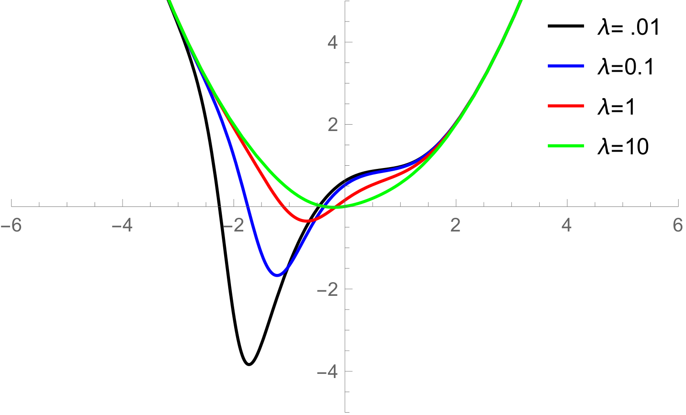
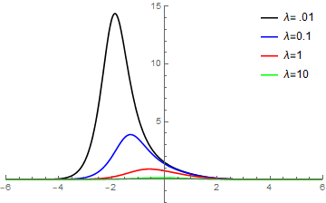
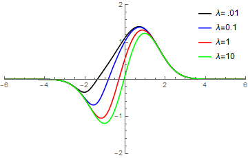

> **原文**：Ojaswini Sharma、Aradhya Shukla，*Analysis of the Fokker-Planck Equation in Schwarzschild Spacetime: A Supersymmetric Connection*，arXiv:2506.04643v1 [hep-th]，2025-06-05（许可：CC BY 4.0）。
> **作者单位**：印度 GLA University（Mathura 281406, Uttar Pradesh）应用科学与人文学院物理系。E-mail：ojaswini.sharma_phd24@gla.ac.in、ashukla038@gmail.com。
> **本文件**：该文的中文译文。公式编号、参考文献编号与原文一一对应，便于回原文核对；专有名词、模型名、方程名与惯用术语（SUSY、SUSY QM、Fokker-Planck、Schwarzschild、Hermite、Bernoulli、Scarf、Pöschl-Teller、FRW、Wheeler-DeWitt、isospectral deformation 等）保留英文。原文 PDF 与 HTML 同在本目录，插图在 `Figs/`。

---

## 摘要

我们借助 Fokker-Planck 方程，重新分析了 Schwarzschild 时空中热势的动力学。我们表明：该 Fokker-Planck 方程可化为一个简化形式，它等价于一个带谐振子势的、经过标度的量子力学问题。在这一框架下，我们指出超对称量子力学（SUSY QM）与 Schwarzschild 度规所对应的 Fokker-Planck 动力学之间存在一个有意思的对应关系。利用等谱形变——SUSY QM 的一个内禀特性——我们导出了一族单参数等谱势。值得注意的是，这一新势族与原谐振子势具有完全相同的能谱，但波函数各不相同。

---

## 1 引言

超对称（SUSY）最早是在场论的语境中被提出的 [1]。粒子分为两族：费米子与玻色子。费米子是物质的基本组成单元，而玻色子传递相互作用 [2]。SUSY 理论把费米子与玻色子相互联系起来，即每一个玻色子都对应一个费米子，反之亦然 [3, 4]。不过，SUSY 迄今尚未得到实验验证 [5]。受场论 SUSY 的启发，人们发展出了量子力学版本的 SUSY [6, 7]。在 SUSY 量子力学（QM）中，存在两个不同的势，称为超对称伙伴（supersymmetric partners），它们具有相同的能谱 [8, 9]。当两个伙伴势享有共同的基态时，称 SUSY 未破缺 [10]；若两势的基态不同，则认为 SUSY 破缺 [11]。

SUSY QM 有一个独特的性质：它能把两个不同的 Hamilton 量联系起来。在这一形式体系中，Hamilton 量被分解为一对 SUSY 伙伴 Hamilton 量 [8]。于是，即便是一个平凡可解的势，也能催生出一类非平凡的势；反过来也一样。例如，自由粒子有一个伙伴势，它可以是周期性的 Scarf 势，也可以是有限深的 Pöschl-Teller 势 [12, 13, 14]。此外，SUSY QM 还提供了许多引人入胜的特性，例如形状不变性（shape invariance）[15, 16, 17] 与等谱形变（isospectral deformation）[7]。形状不变性指的是伙伴势保持相同的函数形式，它使我们无需逐次求解多个方程即可确定完整的谱 [15]。而等谱形变则生成一族势，其能谱与原势完全相同 [18]。不仅如此，等谱形变在重构未知势方面也很有价值，尤其在逆散射问题与成像中 [19, 20]。势的形变过程可以用两种不同的方法完成：平移 [11] 与超势的标度变换 [21]。最近，通过推广这一方法，人们为无反射势构造了双参数与三参数的等谱势 [22]。不过已有工作表明，这两种方法在物理上给出的是相似的结果 [22, 23]。

SUSY QM 在研究复杂的量子力学系统与光学系统时极为有用 [24, 25]。SUSY QM 与光学中 Helmholtz 方程之间的联系已得到充分确立 [26]。借助 SUSY 中的等谱形变，可以为光学系统与光子晶体生成一族折射率分布，它们具有完全相同的光学性质（如反射与折射）[27, 28]。

SUSY QM 的概念已被推广到弯曲时空与宇宙学 [29, 30]。最近，形状不变性这一性质被用于空间平坦的 Friedmann-Robertson-Walker（FRW）模型 [31]，并在相应的 Wheeler-DeWitt 方程的建立中起到关键作用 [32]。此外，人们还在弯曲位形空间中的随机过程与 SUSY QM 之间建立了一种新的联系 [33]。把 SUSY 的 Grassmann 变量引入随机过程，也被证明有助于确定物理的 Lyapunov 指数 [34]，从而对时空中的扰动以及粒子在这些弯曲几何中的运动给出更深的洞见。再者，概率分布的随机演化由 Fokker-Planck（FP）方程支配，而该方程已被推广用于刻画弯曲时空中的扩散现象 [35, 36, 37]。FP 方程为理解引力效应与热效应对黑洞附近粒子随机运动的影响提供了重要洞见 [38, 39]。最近有工作表明，在 FP 框架 [40] 内，Schwarzschild 黑洞的热势等价于一个量子力学谐振子，其离散能级正比于系综温度。通过运用 SUSY 量子力学的形式体系，我们导出了一个新势，它与原势具有相同的能谱、但波函数不同 [41]。这一结果特别有意思，因为该量子系统中粒子运动的概率密度与原先的相比差别很大。

本文安排如下：第 2 节简要讨论 Schwarzschild 度规下的 FP 方程；第 3 节为完整起见，概述 SUSY QM 与等谱形变的基本形式体系；第 4 节致力于建立 SUSY QM 与 FP 方程之间的联系，并生成一个新的单参数等谱势；最后第 5 节作总结。

---

## 2 Schwarzschild 时空与 Fokker-Planck 方程

由热涨落驱动的黑洞相变可以建模为一个随机过程。黑洞各态概率分布的演化，用 FP 形式体系可以有效地分析。取扩散系数 $D$ 为常数、漂移系数 $\mu(x)$ 与时间无关，FP 方程可写为 [39]

$$
\frac{\partial P(x,t)}{\partial t}=\Big[\frac{\partial}{\partial x}f'(x)+D\frac{\partial^{2}}{\partial x^{2}}\Big]P(x,t) \tag{1}
$$

其中 $f(x)=-\int^{x}\mu(y)\,\text{d}y$ 表示势项，$f'(x)=\frac{\text{d}f(x)}{\text{d}x}$，$S(x,t)$ 表示概率流。

对概率密度取 ansatz $P(x,t)=\Phi(x)e^{E\,t}$，并施加相应的边界条件，FP 方程便化为本征值方程

$$
L_{FP}\,\Phi(x)=-E\,\Phi(x). \tag{2}
$$

把势函数用扩散系数标度，即令 $\eta(x)=f(x)/D$，则式 (2) 化为本征值方程 $L\Psi(x)=E\,\Psi(x)$，其中 $\Psi(x)=e^{\eta(x)/2}\Phi(x)$，而算符 $L$ 为

$$
L=-D\frac{\partial^{2}}{\partial x^{2}}+V(x),\quad V(x)=\frac{1}{4D}\left[f'(x)\right]^{2}-\frac{1}{2}f''(x), \tag{3}
$$

它与 Schrödinger 方程中的 Hamilton 算符形式相同。

(3+1) 维 Schwarzschild 黑洞的度规为 [37]

$$
ds^{2}=-\Big(1-\frac{2m}{r}\Big)dt^{2}+\frac{dr^{2}}{1-2m/r}+r^{2}\left(d\theta^{2}+\sin^{2}\theta\,d\phi^{2}\right), \tag{4}
$$

其中 $m$ 表示黑洞的 ADM 质量。Schwarzschild 度规具有球对称性，在 $r=0$ 与 $r=2m$ 处存在奇异性。该黑洞的热势可以算出：$U=\frac{1}{2}r_{h}-\pi Tr_{h}^{2}$，其中 $r_{h}$ 为事件视界、$T$ 为系综温度。需要指出，热势在 $T=T_{h}$ 时取极大值。

为在 FP 方程框架内分析 Schwarzschild 黑洞热势的动力学特征，取势 $f(x)=\frac{1}{2}x-\pi Tx^{2}$，于是有效势为

$$
V(x)=\Big(\pi^{2}T^{2}D\Big)y^{2}+\pi T,\quad y=x-\Big(1/4\pi T\Big). \tag{5}
$$

由式 (3) 与 (4) 很容易得到最简形式的 FP 方程

$$
\pi T\Big[-\frac{\partial^{2}}{\partial\zeta^{2}}+\big(1+\zeta^{2}\big)\Big]\Psi(x)=E\,\Psi(x), \tag{6}
$$

其中 $\zeta=\sqrt{\pi T/D}\,y$ 是辅助变量。

上式即量子力学谐振子（相差一个常数因子）。由此可得能量本征值与本征函数

$$
\begin{aligned}
E_{n}&=2\pi T(n+1),\\
\Psi_{n}(x)&=\Big(\frac{T}{D}\Big)^{1/4}\frac{1}{\sqrt{2^{n}n!}}\,H_{n}(\zeta)\,e^{-\zeta^{2}/2},
\end{aligned}\qquad n=0,1,2,\dots \tag{7}
$$

其中 $H_{n}(\zeta)$ 是 Hermite 多项式。

下一节的目标，是把 Schwarzschild 度规热势的 Fokker-Planck 动力学与超对称量子力学联系起来。我们将简要讨论 SUSY QM 的基本性质，以及 SUSY QM 中的等谱形变——后者能针对原势生成一类新势。

---

## 3 超对称量子力学中的等谱形变

我们从任意给定势 $V(x)$ 的 Hamilton 量出发，

$$
H=-\frac{d^{2}}{dx^{2}}+V, \tag{8}
$$

可以按如下方式生成两个相互联系的超伙伴 Hamilton 量 [7, 9]：

$$
H_{+}=A^{+}A,\qquad H_{-}=AA^{+}, \tag{9}
$$

其中

$$
A=\frac{d}{dx}+W(x),\qquad A^{\dagger}=-\frac{d}{dx}+W(x), \tag{10}
$$

$W(x)$ 是超势（superpotential），与势 $V(x)$ 相联系。把 $A$ 与 $A^{\dagger}$ 代入式 (9)，即可得到 $H$ 的两种不同形式，即 $H_{+}$ 与 $H_{-}$ [18, 14]：

$$
H_{+}=-\frac{d^{2}}{dx^{2}}+W^{2}+W', \tag{11}
$$

$$
H_{-}=-\frac{d^{2}}{dx^{2}}+W^{2}-W', \tag{12}
$$

其中撇号表示对空间坐标求导。比较式 (8)、(11) 与 (12)，可得用超势 $W$ 表示的伙伴势 $V_{+}$ 与 $V_{-}$ [11, 22]：

$$
V_{+}=W^{2}+W',\qquad V_{-}=W^{2}-W'. \tag{13}
$$

需要指出，$V_{+}$ 与 $V_{-}$ 具有相同的能量本征值，并享有共同的基态。

对系统判据作连续改变、而使其谱保持不变，是研究非平凡 QM 系统的独特方法之一。在 SUSY QM 中，等谱形变被用来构造一个与原势具有相同本征谱的新势；由此可以生成一族物理上不同、但谱上相似的 Hamilton 量。在等谱形变中，与给定伙伴势相应的超势被一个一般的空间函数所平移。值得注意的是，等谱势不一定是原势的 SUSY 伙伴势。我们把原势作如下平移 [11]：

$$
W_{1}(x)=W(x)+f(x), \tag{14}
$$

其中 $f(x)$ 是一个与空间有关的函数。把式 (14) 代入 (13)，得到一个条件

$$
f(x)^{2}+2W(x)f(x)+\frac{df}{dx}=0, \tag{15}
$$

称为 Bernoulli 方程。该方程有如下形式的解

$$
f(x)=\frac{e^{-\int 2W(x)\,\text{d}x}}{\lambda_{1}-\int e^{-\int 2W(x)\,\text{d}x}\,\text{d}x}, \tag{16}
$$

其中 $\lambda$ 为积分常数。在这一条件下，$V_{-}$ 保持不变，而生成一个新形式的势 $V_{+}$。需要注意，等谱形变只作用在系统的"边界"上，使原势保持一致。它允许人们发展出一族完全不同的势，而这些势未必与原势 SUSY 等价 [9]。

在后续各节中，我们将讨论 Schwarzschild 时空 FP 方程的动力学，并把它与 SUSY QM 联系起来。最近已有工作表明，对应于 Schwarzschild 度规的 FP 方程收敛到带谐振子势的 Schrödinger 方程。我们运用 SUSY QM 中等谱形变这一手段，去找出一个新版本的势，它与原势具有相同的本征谱、但本征函数不同。

---

## 4 Fokker-Planck 方程与等谱形变：超对称的联系

本节在 SUSY QM 的背景下讨论 FP 方程的动力学。Schwarzschild 时空的 FP 方程化为 Schrödinger 方程

$$
\pi T\Big[-\frac{\partial^{2}}{\partial\zeta^{2}}+\big(1+\zeta^{2}\big)\Big]\Psi(x)=E\,\Psi(x), \tag{17}
$$

其中有效势 $V=1+\zeta^{2}$ 是标度后的谐振子势，$\zeta=\sqrt{\pi T/D}\,y$，$y=x-\big(1/4\pi T\big)$。现在，我们利用 SUSY QM 中等谱形变的特性来生成一个新势 [22, 23]。与式 (17) 中势相对应的超势为 $W(\zeta)=\zeta$。如上一节所述，我们用一个一般函数来平移超势：

$$
W(\zeta)\longrightarrow\tilde{W}(\zeta)=W(\zeta)+f(\zeta), \tag{18}
$$

在 Bernoulli 方程之下，上式给出

$$
f(x)=\frac{2e^{-\zeta^{2}}}{\sqrt{\pi}\left(\mathrm{erf}(\zeta)+\lambda\right)}. \tag{19}
$$

利用式 (18) 与 (19)，得到新的超势

$$
\tilde{W}(x)=\zeta+\frac{2e^{-\zeta^{2}}}{\sqrt{\pi}\left(\mathrm{erf}(\zeta)+\lambda\right)}. \tag{20}
$$

上述超势的函数形式不同，但它使原势保持不变，即 $\tilde{V}_{-}=V_{-}$。然而，利用式 (17)、(18) 与 (20)，可以得到一个形变后的势 $\tilde{V}_{+}$，形如

$$
\tilde{V}_{+}=1+\zeta^{2}+\frac{2e^{-\zeta^{2}}}{\sqrt{\pi}\left(\mathrm{erf}(\zeta)+1+\lambda\right)}\Bigg[\frac{e^{-\zeta^{2}}}{\sqrt{\pi}\left(\mathrm{erf}(\zeta)+1+\lambda\right)}+2\zeta\Bigg], \tag{21}
$$

其中 $\lambda$ 为常数参数。应当指出，上述势将给出与式 (7) 中原势相同的本征值。现在，通过简单的数学运算即可求出基态（$\tilde{\psi}^{(0)}_{1}(\zeta)$）与第一激发态（$\tilde{\psi}^{(1)}_{1}$）：

$$
\tilde{\psi}^{(0)}_{1}(\zeta)\propto\frac{2e^{-\zeta^{2}/2}}{\mathrm{erf}(\zeta)+1+\lambda}, \tag{22}
$$

$$
\tilde{\psi}^{(1)}_{1}\propto 2\zeta e^{\zeta^{2}/2}+\sqrt{\frac{1}{\pi}}\,\frac{2e^{-3\zeta^{2}/2}}{\mathrm{erf}(\zeta)+1+\lambda}. \tag{23}
$$

类似地，借助产生算符

$$
\tilde{A}^{\dagger}=\zeta-\sqrt{\frac{1}{\pi}}\,\frac{-2e^{\zeta^{2}}}{\mathrm{erf}(\zeta)+1+\lambda}+\frac{d}{d\zeta}, \tag{24}
$$

可以得到第 $n$ 个激发态：

$$
\tilde{\psi}^{(n)}_{1}\propto\Big[\zeta+\sqrt{\frac{1}{\pi}}\,\frac{2e^{-\zeta^{2}}}{\mathrm{erf}(\zeta)+1+\lambda}-\frac{d}{d\zeta}\Big]\Big[\zeta+\frac{d}{d\zeta}\Big]\Big[-\zeta+\frac{d}{dx}\Big]^{n}e^{-\zeta^{2}/2}.
$$

该等谱势连同其相应的基态与第一激发态波函数，在参数 $\lambda$ 取多个值时一并给出（图 1；图中 $\lambda=0.01,\,0.1,\,1,\,10$）。

*图 1(a)：等谱势 $\tilde{V}_{+}(x)$。$\lambda$ 越小，原点附近的形变越剧烈；$\lambda$ 增大时各曲线趋于同一渐近形式。*

*图 1(b)：等谱势的基态波函数 $\tilde{\psi}^{(0)}_{1}$。*

*图 1(c)：等谱势的第一激发态波函数 $\tilde{\psi}^{(1)}_{1}$，可见节点位置随 $\lambda$ 移动。*

如图所示，等谱势在原点附近强烈依赖于参数 $\lambda$。当 $\lambda$ 由小到大（小到中等）时，各势之间差别明显；但随着 $\lambda$ 增大，这些差别逐渐减小，收敛到一个普适的渐近形式。类似地，相应的波函数在 $x=0$ 附近的振幅与曲率上变化显著，但它们都通过在无穷远处趋于零而满足可归一性。值得注意的是，波函数节点的大小与位置随 $\lambda$ 移动；这说明尽管能谱不变，$\lambda$ 对局域的量子态性质仍有决定性影响。

---

## 5 结论

本文凸显了 SUSY QM 框架中等谱形变的重要性。具体而言，我们运用 SUSY QM 形式体系研究了与 Schwarzschild 度规相联系的 FP 方程，其中相应的热势有效地化为谐振子型势。与等谱 Hamilton 量相应的波函数，其结构特征与原 Hamilton 量 $H$ 的波函数明显不同。当参数 $\lambda$ 取不同值时，等谱势在原点附近表现出显著的偏离。参数 $\lambda$ 调节形变的强度与性质，从而直接影响局域的势剖面。相应地，波函数在原点附近也表现出显著变化；不过，尽管存在这些局域差异，相关波函数仍渐近地趋于零，从而保持平方可积性并确保其物理有效性。因此，概率密度与节点分布对 $\lambda$ 高度敏感，尤其是在势发生实质改变的区域。这些结果阐明了谱的等谱性与空间非等价性之间微妙的相互作用，并在量子调控与谱设计中具有潜在应用——在这类场合，人们希望在不改变整体谱的前提下裁剪局域波函数的性质。需要指出，有效势是在 FP 形式体系下由 Schwarzschild 时空的倒谐振子热势得到的。倒谐振子在描述宇宙学奇点与暴胀情形中扮演重要角色。倒谐振子的等谱行为与 $\mathcal{PT}$ 对称行为正在研究中，将另文报告。

---

## 参考文献

1. J. Wess, J.A. Bagger, *Supersymmetry and Supergravity: Revised Edition*, Princeton University Press, 2020.
2. S. Weinberg, *The Quantum Theory of Fields: Volume 3, Supersymmetry*, Cambridge University Press, 2005.
3. J.G. Polchinski, *Superstring Theory and Beyond*, 2005.
4. S. Weinberg, *The Quantum Theory of Fields: Volume 2*, Cambridge University Press, 1995.
5. R. Mann, *An Introduction to Particle Physics and the Standard Model*, Taylor and Francis, 2010.
6. E. Witten, *Dynamical breaking of supersymmetry*, Nucl. Phys. B **188** (1981) 513–554.
7. F. Cooper, A. Khare, U. Sukhatme, *Supersymmetry and quantum mechanics*, Phys. Rep. **251** (1995) 267–385.
8. A. Khare, U. Sukhatme, *Phase-equivalent potentials obtained from supersymmetry*, J. Phys. A: Math. Gen. **22** (1989) 2847.
9. R. Dutt, A. Khare, U.P. Sukhatme, *Supersymmetry, shape invariance, and exactly solvable potentials*, Am. J. Phys. **56** (1988) 163–168.
10. F. Cooper, B. Freedman, *Aspects of supersymmetric quantum mechanics*, Ann. Phys. **146** (1983) 262–288.
11. A. Gangopadhyaya, J.V. Mallow, C. Rasinariu, *Supersymmetric Quantum Mechanics: An Introduction*, World Scientific, 2017.
12. F.L. Scarf, *New soluble energy band problem*, Phys. Rev. **112** (1958) 1137.
13. G. Pöschl, E. Teller, *Bemerkungen zur Quantenmechanik des anharmonischen Oszillators*, Z. Phys. **83** (1933) 143–151.
14. A. Pal, S. Modak, A. Shukla, P.K. Panigrahi, *PT-symmetry and supersymmetry: interconnection of broken and unbroken phases*, Proc. R. Soc. A **477** (2021) 20210494.
15. A. Gangopadhyaya, J.V. Mallow, U.P. Sukhatme, *Broken supersymmetric shape invariant systems and their potential algebras*, Phys. Lett. A **283** (2001) 279–284.
16. L.É. Gendenshteĭn, *Derivation of exact spectra of the Schrödinger equation by means of supersymmetry*, JETP Lett. **38** (1983) 356–359.
17. J. Bougie, A. Gangopadhyaya, J.V. Mallow, *Generation of a complete set of additive shape-invariant potentials from an Euler equation*, Phys. Rev. Lett. **105** (2010) 210402.
18. B. Mielnik, *Factorization method and new potentials with the oscillator spectrum*, J. Math. Phys. **25** (1984) 3387–3389.
19. S. Novikov, S.V. Manakov, L.P. Pitaevskii, V.E. Zakharov, *Theory of Solitons: The Inverse Scattering Method*, Springer, 1984.
20. C.V. Sukumar, *Supersymmetric quantum mechanics and the inverse scattering method*, J. Phys. A: Math. Gen. **18** (1985) 2937.
21. B.S. Jensen, J.B. Nielsen, J. Larsen, *Efficient preference learning with pairwise continuous observations and Gaussian processes*, in: Proc. IEEE Int. Workshop Mach. Learn. Signal Process., 2011, pp. 1–6.
22. E. Baby, A. Shukla, S. Gupta, *Bridging trails in reflectionless potential deformation: two paths and one horizon*, Phys. Lett. A **517** (2024) 129655.
23. P. Roy, *Comment on "A novel class of isospectral deformations in supersymmetric quantum mechanics" by B. Jensen*, JHEP **10** (2012) 1–4.
24. S. Klaiman, U. Günther, N. Moiseyev, *Visualization of branch points in PT-symmetric waveguides*, Phys. Rev. Lett. **101** (2008) 080402.
25. A. Macho, R. Llorente, C. García-Meca, *Supersymmetric transformations in optical fibers*, Phys. Rev. Appl. **9** (2018) 014024.
26. J. Čtyroký, V. Kuzmiak, S. Eyderman, *Waveguide structures with antisymmetric gain/loss profile*, Opt. Express **18** (2010) 21585–21593.
27. M. Heinrich, M.-A. Miri, S. Stützer, R. El-Ganainy, S. Nolte, A. Szameit, D.N. Christodoulides, *Supersymmetric mode converters*, Nat. Commun. **5** (2014) 3698.
28. C. García-Meca, A.M. Ortiz, R. Llorente Sáez, *Supersymmetry in the time domain and its applications in optics*, Nat. Commun. **11** (2020) 813.
29. P.V. Moniz, *Quantum Cosmology: The Supersymmetric Perspective Vol. 1: Fundamentals*, Springer, 2010.
30. P.V. Moniz, *Quantum Cosmology: The Supersymmetric Perspective Vol. 2*, Springer, 2010.
31. S. Jalalzadeh, T. Rostami, P.V. Moniz, *Quantum cosmology: from hidden symmetries towards a new (supersymmetric) perspective*, Int. J. Mod. Phys. D **25** (2016) 1630009.
32. S. Jalalzadeh, S.M.M. Rasouli, P. Moniz, *Shape invariant potentials in supersymmetric quantum cosmology*, Universe **8** (2022) 316.
33. R. Graham, D. Roekaerts, *Supersymmetric quantum mechanics and stochastic processes in curved configuration space*, Phys. Lett. A **109** (1985) 436–440.
34. R. Graham, *Lyapunov exponents and supersymmetry of stochastic dynamical systems*, Europhys. Lett. **5** (1988) 101.
35. J. Maldacena, S.H. Shenker, D. Stanford, *A bound on chaos*, JHEP **08** (2016) 1–17.
36. V. Cardoso, A.S. Miranda, E. Berti, H. Witek, V.T. Zanchin, *Geodesic stability, Lyapunov exponents, and quasinormal modes*, Phys. Rev. D **79** (2009) 064016.
37. Y.-Q. Lei, X.-H. Ge, *Circular motion of charged particles near a charged black hole*, Phys. Rev. D **105** (2022) 084011.
38. R. Zwanzig, *Nonequilibrium Statistical Mechanics*, Oxford University Press, 2001.
39. H. Risken, T.K. Caughey, *The Fokker-Planck Equation: Methods of Solution and Application*, 1991.
40. Z.-M. Xu, *Fokker-Planck equation for black holes in thermal potential*, Phys. Rev. D **104** (2021) 104022.
41. F. Cooper, J.N. Ginocchio, A. Khare, *Relationship between supersymmetry and solvable potentials*, Phys. Rev. D **36** (1987) 2458.

---

## 译者说明

1. **术语**：SUSY、SUSY QM、Fokker-Planck（FP）、Schwarzschild、Hermite、Bernoulli、Scarf、Pöschl-Teller、FRW、Wheeler-DeWitt、Hamilton、Schrödinger、Grassmann、Helmholtz、Lyapunov、isospectral deformation、superpotential、shape invariance 等保留英文（原文给出的中文对照只在首次出现处补注）。其余按通行中文译法：系综温度、热势、有效势、本征值/本征函数、概率流、漂移系数、扩散系数、等谱势、伙伴势、产生算符、可归一性。
2. **公式编号**：与原文 (1)–(24) 完全一致（`\tag{}` 即原编号）。原文式 (7) 是同一编号下的三行（本征值、本征函数、"with n = 0,1,2…"），译文合并为一个 `aligned` 公式块、仍标 (7)。式 (24) 之后"第 $n$ 个激发态"那个公式在原文中**没有编号**（原文只到 (24)），译文同样不编号。
3. **插图位置**：原文只有一幅图（Figure 1，含 a/b/c 三个子图），论文中排在第 4 节末尾、图注之下有一段文字讨论。译文按 `agent.md` §8，把三个子图分别内嵌在其被讨论处的正文旁（即"该等谱势…一并给出（图 1）"这句之后），图注用斜体另起一行。
4. **插图文件**：`Figs/2506_Fig1_Pot.png`、`Fig1_psi0.png`、`Fig1_psi1.png`。其中 `Pot` 这一子图在 arXiv 上以矢量 PDF 形式提供（HTML 里虽写作 `Pot.png`，服务器返回的实为 PDF），本次已按 300 dpi 栅格化为真正的 PNG，否则 Obsidian 无法显示；`psi0`/`psi1` 两子图的原始位图只有 360×224 与 360×230 像素（作者提供的即为该分辨率，论文 PDF 里嵌入的也是这两个位图），故清晰度受限，这是原文固有的。
5. **原文瑕疵照留**（只在本地说明，正文按原文照译）：
   - 式 (5) 写作 $V=(\pi^{2}T^{2}D)y^{2}+\pi T$，即 $D$ 在分子；但由式 (3) 与 $f=\frac12x-\pi Tx^{2}$ 直接代入应得 $\pi^{2}T^{2}y^{2}/D+\pi T$（$D$ 在分母）。式 (6) 的化简结果 $\pi T[-\partial_\zeta^{2}+(1+\zeta^{2})]$ 也只有在 $D$ 位于分母时才成立。此处按原文保留。（式 (6)/(17) 的逐步推导、以及"$D$ 若真在分子会得到 $\pi T[-\partial_\zeta^{2}+(1+D^{2}\zeta^{2})]$"的核对，见本目录 `备注-超对称等谱形变.md` 的 **Q2**。）
   - 式 (19)、(20) 的自变量在原文中混用 $x$ 与 $\zeta$（左端写 $x$、右端写 $\zeta$）；式 (22)、(23) 直接用了 $\zeta$。
   - 式 (23) 含因子 $e^{+\zeta^{2}/2}$，在 $|\zeta|\to\infty$ 时发散，与"波函数可归一"的论断不一致，疑为 $e^{-\zeta^{2}/2}$ 的排版错误。
   - 末式（第 $n$ 个激发态）中括号里写作 $\big[-\zeta+\frac{d}{dx}\big]^{n}$，把 $\zeta$ 的导数写成了对 $x$ 的导数，与全文其余部分的 $\frac{d}{d\zeta}$ 不一致。
   - 文字性笔误：式 (15) 前后把 Bernoulli 写作 "Bernouli"；§3 中 "isopectral"（应为 isospectral）、"matric"（应为 metric）；图注 "First excited state for for various values"（重复 for）；§4 小标题 "Supersymmentric"（应为 Supersymmetric）。译文按正确拼写处理，不另标注。
   - 原文未设致谢小节；资助信息未给出。
