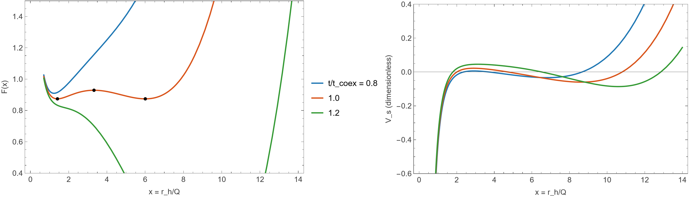
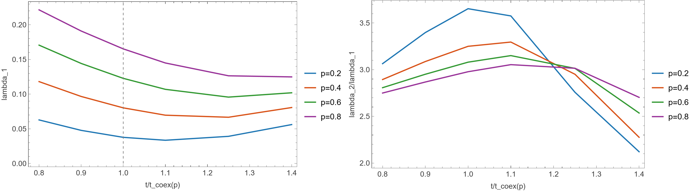
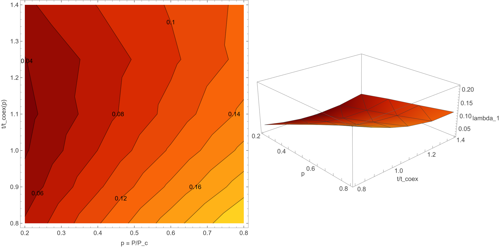
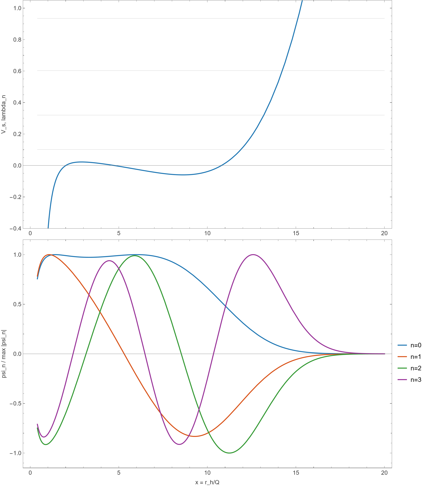
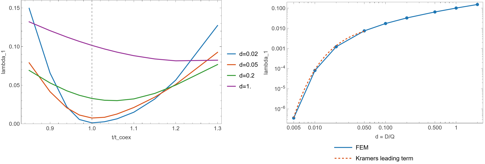

**任务**：取 arXiv:2111.05856 Table 1 的 Charged AdS 热势，求其 Fokker–Planck 算符对应的薛定谔型本征值问题。本文采用常扩散、单位迁移率的半轴模型，并将谱解释为经典概率分布的弛豫率。

**修订日期：2026-11-09。** 公式、数值表和图表使用统一的无量纲记号；复现脚本及原始数值输出位于本目录。

| 项目 | 结果 |
| --- | --- |
| 数学模型 | $x=r_h/Q>0$，$p=P/P_c>0$，$d=D/Q>0$ |
| 算符 | $\widetilde L=-d\partial_x^2+\widetilde V_s$，$\widetilde V_s=F'^2/(4d)-F''/2$ |
| 端点条件 | 奇异端点处取平方可积衰减支；有限盒子的反射 Robin 与吸收 Dirichlet 条件需分别处理 |
| 精确基态 | $\lambda_0=0$，$\psi_0=Z^{-1/2}e^{-F/(2d)}$，$Z=\int_0^\infty e^{-F/d}\,dx$ |
| 激发态 | 本文数值求解；代表谱及主要采样表经过网格与盒子核对 |
| 谱的性质 | 非等间距，依赖 $d$；$\lambda_n=Q\varepsilon_n$ 是无量纲衰减率 |
| 弱噪声 | 两井存在且 $d\ll\Delta F$ 时，$\lambda_1\sim k_{s\to l}+k_{l\to s}$，呈 Eyring–Kramers 指数渐近 |
| 共存附近 | 最慢弛豫率出现低谷，极小温度偏离严格共存温度 $O(d)$；主因是两侧势垒对温度的敏感度不同，两井曲率差的作用方向相反且较弱（见六.3） |

## 一、热势、动力学与无量纲化

令有量纲半径为 $r$，固定电荷 $Q>0$ 与压强 $P$。热势为

$$
f(r)=\frac r2+\frac{4\pi P}{3}r^3+\frac{Q^2}{2r}-\pi Tr^2=M(r)-TS(r). \tag{1}
$$

这里采用 $G=\hbar=c=k_B=1$ 的单位约定。**2111 Table 1 把同一个式子写作 $f(x)$，但那个 $x$ 就是 $r_h$ 本身（有量纲），不是无量纲量；本文一律用 $r$ 表示有量纲半径、用 $x$ 表示 $r/Q$。为什么这样区分见 Q2。**

固定 $P,Q$ 时，

$$
T_h(r)=\frac1{4\pi r}\left(1+8\pi Pr^2-\frac{Q^2}{r^2}\right),\qquad S=\pi r^2,
$$

故 $\mathrm df=(T_h-T)\,\mathrm dS$。导数为

$$f_r=\frac12+4\pi Pr^2-\frac{Q^2}{2r^2}-2\pi Tr,\qquad
f_{rr}=8\pi Pr+\frac{Q^2}{r^3}-2\pi T. \tag{2}$$

用 $s$ 表示演化时间，避免与约化温度 $t$ 混用。采用论文的单位迁移率模型，

$$\partial_s W=\partial_r(f_r W)+D\partial_r^2 W,\qquad
J=-(f_rW+D\partial_rW),\qquad D>0. \tag{3}$$

对 $W(r,s)=\varphi(r)e^{-\varepsilon s}$，取 $\psi=e^{f/(2D)}\varphi$，得到

$$L\psi=-D\psi_{rr}+
\left(\frac{f_r^2}{4D}-\frac{f_{rr}}2\right)\psi=\varepsilon\psi. \tag{4}$$

（这里的 $L=-e^{f/(2D)}L_{\rm FP}e^{-f/(2D)}$ 是 $L_{\rm FP}$ 的相似变换，不是新假设；三步推导见 **Q3**。）

式 (3) 是本文的动力学假设。热势本身没有唯一规定迁移率与噪声强度。若物理 FP 方程为
$\partial_sW=\Gamma\partial_r(f_rW)+D_{\rm phys}\partial_r^2W$，则式 (3) 中的 $D$ 对应 $D_{\rm phys}/\Gamma$，物理衰减率还需乘 $\Gamma$。把噪声与浴温联系起来时，应另给涨落耗散约定。（若要求平衡分布就是系综温度 $T$ 下的正则分布 $e^{-f/T}$，则 $D_{\rm phys}/\Gamma=T$，$d$ 不再自由：$d=T/Q=\sqrt6t/(18\pi Q^2)$。这对 $d$ 轴物理含义的影响见文末 **Q1 第三节**。）

临界量为

$$
P_c=\frac1{96\pi Q^2},\qquad T_c=\frac{\sqrt6}{18\pi Q},\qquad r_c=\sqrt6Q.
$$

定义

$$p=\frac P{P_c},\qquad t=\frac T{T_c},\qquad
x=\frac rQ=\sqrt6X,\qquad d=\frac DQ,\qquad \tau=\frac sQ.$$

于是 $p_c=t_c=1$、$x_c=\sqrt6$、$X_c=1$。写 $f(r)=QF(x)$，有

$$
F(x)=\frac x2+\frac p{72}x^3+\frac1{2x}-\frac{\sqrt6}{18}tx^2, \tag{5}
$$

$$F'=\frac12+\frac p{24}x^2-\frac1{2x^2}-\frac{\sqrt6}{9}tx,\qquad
F''=\frac p{12}x+\frac1{x^3}-\frac{\sqrt6}{9}t.$$

无量纲本征值问题是

$$\widetilde L\psi=-d\psi''+\widetilde V_s\psi=\lambda\psi,\qquad
\lambda=Q\varepsilon,\qquad \widetilde L=QL, \tag{6}$$

$$\boxed{\widetilde V_s=\frac1{4d}
\left(\frac12+\frac p{24}x^2-\frac1{2x^2}-\frac{\sqrt6}{9}tx\right)^2
-\frac12\left(\frac p{12}x+\frac1{x^3}-\frac{\sqrt6}{9}t\right)}. \tag{7}$$

下文所有表格给出 $\lambda_n$，恢复有量纲衰减率时用 $\varepsilon_n=\lambda_n/Q$。有量纲有效势为 $V_s=\widetilde V_s/Q$；式 (7) 本身无量纲。

*图 1：$p=0.5,d=1$，三条曲线对应 $t/t_{\rm coex}=0.8,1.0,1.2$。左图黑点标出共存温度时 $F$ 的三个驻点。$F$ 与 $\widetilde V_s$ 是不同的势，它们的极值位置一般不同。*

## 二、定义域和边界条件

### 1. 本文采用的半轴模型

本文把式 (5) 当作定义在 $x\in(0,\infty)$ 上的 off-shell 势，采用该半轴上的保守扩散。$x=0$ 的极点阻止将本例直接延拓为全实轴问题。

若要求每个半径都对应 RN–AdS 的外视界，则需使用 $r\ge r_{\rm ext}$，其中

$$1+8\pi Pr_{\rm ext}^2-\frac{Q^2}{r_{\rm ext}^2}=0,\qquad
x_{\rm ext}^2=\frac{6(\sqrt{1+p/3}-1)}p.$$

例如 $p=0.5$ 时 $x_{\rm ext}\simeq0.98055$。这是另一种定义域选择：该有限下端还需指定边界条件，谱不能默认与本文的 $(0,\infty)$ 结果相同。本文数值表全部对应形式上的完整正半轴。（$x<x_{\rm ext}$ 区间 $T_h<0$，不对应任何黑洞；它在 $d=1$ 时占平衡概率约 6%，改在 $x_{\rm ext}$ 处取反射边界会使 $\lambda_1$ 变化约 12%，定量见文末 **Q1 第二节第 2 条**。）

### 2. 奇异端点与有限盒子

对 $p>0,d>0$，

$$F(x)\sim\frac1{2x}\quad(x\to0^+),\qquad
F(x)\sim\frac p{72}x^3\quad(x\to\infty),$$

$$\widetilde V_s\sim\frac1{16dx^4}\quad(x\to0^+),\qquad
\widetilde V_s\sim\frac{p^2x^4}{2304d}\quad(x\to\infty).$$

两端为 limit-point 奇异端点。取平方可积衰减支即可确定自然的自伴算符；不存在可任意选择的端点自伴参数。有效势在两端发散，谱离散。在 FP 模型中，这对应内点扩散无法到达的端点与保守演化。

数值上用有限区间 $[a,b]$ 截断时，以下两种条件不同：

$$\begin{aligned}
\text{反射：}\quad &J=0
\iff d\psi'+\frac{F'}2\psi=0,\\
\text{吸收：}\quad &W=0\iff\psi=0.
\end{aligned} \tag{8}$$

有限反射盒子精确保留 $e^{-F/(2d)}$ 的零模；有限吸收盒子的基态本征值严格为正（$\widetilde L=A^\dagger A\ge0$，零本征值要求 $A\psi=0$ 即 $\psi\propto e^{-F/(2d)}$，它在端点不为零，与 Dirichlet 条件矛盾）。端点进入足够小的尾部后，它们的低谱可以接近同一个半轴极限，但这种接近需要数值验证。

2111.05856 对 $\Phi\to-\infty$ 情形写出的条件 $e^\Phi W\to0$，不能直接搬到这里的 $\Phi\to+\infty$。本文基态满足 $e^{F/(2d)}\psi_0=Z^{-1/2}\ne0$，故该条件不被可归一性自动满足。

### 3. 两端渐近与盒子选择

完整有效势展开为

$$\begin{aligned}
\widetilde V_s={}&\frac{p^2x^4}{2304d}
-\frac{ptx^3}{72\sqrt6d}
+\left(\frac p{96d}+\frac{t^2}{54d}\right)x^2\\
&-\left(\frac p{24}+\frac t{6\sqrt6d}\right)x
+\frac1{16d}-\frac p{96d}+\frac t{3\sqrt6}\\
&+\frac t{6\sqrt6dx}-\frac1{8dx^2}
-\frac1{2x^3}+\frac1{16dx^4}.
\end{aligned} \tag{9}$$

左端衰减解有 $\psi\sim C e^{-1/(4dx)}[1+O(x)]$；右端的主导对数满足
$\log|\psi|\sim-px^3/(144d)$。对于精确基态，完整指数是

$$\psi_0=C\exp\left[-\frac{px^3}{144d}
+\frac{\sqrt6tx^2}{36d}-\frac{x}{4d}-\frac1{4dx}\right]. \tag{10}$$

二次、一次指数项对有限盒子很重要。不存在仅由 $p\ge0.1,d\ge0.02$ 就能保证 $[0.01,40]$ 足够的统一规则；温度和噪声强度也影响尾部。

例如 $p=0.1,t=1.4t_{\rm coex}(0.1),d=1$ 时，大井在 $x_l\simeq29.42549$，基态在 $x=40$ 的平方幅度与峰值之比约 $5.26\times10^{-4}$。扩大盒子得到（吸收 Dirichlet 截断；除四.2 的边界对比外，全文数值表均用此截断，即脚本 `feValues` 的默认值，故 $b=40$ 行的 $\lambda_0=9.67\times10^{-5}$ 是吸收截断误差，不是反射盒子零模的残余）：

| 盒子 | $\lambda_0$ | $\lambda_1$ | $\lambda_2$ | $\lambda_3$ |
| --- | --- | --- | --- | --- |
| $[0.01,40]$ | 9.67e-5 | 0.03481586 | 0.09312254 | 0.13356730 |
| $[0.01,60]$ | -6.89e-12 | 0.03481583 | 0.09276580 | 0.13335054 |
| $[0.01,80]$ | 9.04e-12 | 0.03481583 | 0.09276580 | 0.13335054 |

此处 $b=60$ 与 $80$ 的谱稳定，而 $b=40$ 的基态与部分激发态有可见截断误差。下文主要谱表逐行比较了 $[0.01,40]$ 与 $[0.005,60]$，不能把这一核对外推为所有参数的保证。

## 三、解析结构

### 1. 精确零模与平衡分布

直接微分 $\psi_0=e^{-F/(2d)}$，得

$$\psi_0''=\left(-\frac{F''}{2d}+\frac{F'^2}{4d^2}\right)\psi_0,\qquad
\widetilde L\psi_0=0.$$

一般而言，零模存在需要 $Z=\int_{\mathcal I}e^{-F/d}\,dx<\infty$，且 $\psi_0$ 属于指定算符定义域。不能仅用“势在两端趋于正无穷”作为一般充要条件：有限端点也可能允许零模，远端增长太慢又可能不能归一。

对本文的 $p>0,d>0$ 势，式 (10) 确保 $Z<\infty$。在保守半轴定义域上，

$$\boxed{\lambda_0=0,\qquad
\psi_0=Z^{-1/2}e^{-F/(2d)},\qquad
W_{\rm eq}=Z^{-1}e^{-F/d}.} \tag{11}$$

$\lambda_0=0$ 是解析结论。有限元或有限差分输出的近零残余应记录为离散化与截断误差，不能通过强制置零来证明数值精度。

### 2. SUSY 伙伴关系

令

$$A=\sqrt d\left(\partial_x+\frac{F'}{2d}\right),\qquad
A^\dagger=\sqrt d\left(-\partial_x+\frac{F'}{2d}\right),$$

则 $\widetilde L=A^\dagger A$，而

$$\widetilde L_1=AA^\dagger
=-d\partial_x^2+\frac{F'^2}{4d}+\frac{F''}2. \tag{12}$$

在相容定义域上 $\widetilde L\ge0$。本文半轴的零模正常化，伙伴零模 $e^{F/(2d)}$ 不正常化，故

$$\operatorname{spec}\widetilde L=\{0\}\cup\operatorname{spec}\widetilde L_1,\qquad
\psi_n=\lambda_n^{-1/2}A^\dagger\chi_{n-1}\quad(n\ge1). \tag{13}$$

有限盒子也须映射边界条件：原算符反射条件 $A\psi=0$ 对应伙伴的 Dirichlet 条件。给两个算符都施加有限盒子 Dirichlet 时，只有端点尾部足够小时才能近似比较半轴等谱关系。

本例没有找到激发态的闭式表达；本文用数值求谱。2506.04643 在谐振子上研究的 SUSY 等谱形变可提供代数参考，但不会自动给出本例的可解谱。

### 3. 临界点与共存线

$F'=F''=0$ 给出

$$
p x^4-12x^2+36=0.
$$

三驻点窗口要求 $0<p<1$；临界点是 $p=t=1,x=\sqrt6$。共存条件是

$$
F'(x_s)=F'(x_l)=0,\qquad F(x_s)=F(x_l),\qquad x_s<x_l.
$$

对本例可写出

$$
\boxed{t_{\rm coex}(p)=\sqrt{\frac{p(3-\sqrt p)}2}},\qquad0<p<1. \tag{14}
$$

$t_{\rm coex}(p)$ 是约化共存温度，临界温度的约化值仍是 1。后文横坐标统一记为 $\rho=t/t_{\rm coex}(p)$。

| $p$ | $x_s$ | $x_l$ | $t_{\rm coex}$ |
| --- | --- | --- | --- |
| 0.1 | 1.12820 | 16.81762 | 0.36631764 |
| 0.2 | 1.20051 | 11.17556 | 0.50525107 |
| 0.3 | 1.26853 | 8.63557 | 0.60649948 |
| 0.4 | 1.33814 | 7.08957 | 0.68811983 |
| 0.5 | 1.41299 | 6.00519 | 0.75711512 |
| 0.6 | 1.49696 | 5.17448 | 0.81708078 |
| 0.7 | 1.59574 | 4.49407 | 0.87015458 |
| 0.8 | 1.72015 | 3.89978 | 0.91773042 |
| 0.9 | 1.89855 | 3.33126 | 0.96077704 |

$p=0.5$ 的三驻点窗口约为 $t\in(0.73254,0.84462)$，共存温度为 $0.7571151198486021$。

## 四、数值方法与误差核对

修订脚本采用显式均匀二次有限元网格；$h_{\rm FE}$ 指元素长度上限。反射条件用带外法向符号的 NeumannValue 实现。独立方法为中心二阶有限差分、稀疏三对角矩阵求谱，采用实际网格步长做 Richardson 外推。保存的 JSON 保留未经 Chop 的原始值。

### 1. 代表参数收敛

$p=0.5,t=t_{\rm coex},d=1$：

| 设置 | $\lambda_0$ | $\lambda_1$ | $\lambda_2$ | $\lambda_3$ |
| --- | --- | --- | --- | --- |
| FE $[0.02,25]$, $h=0.004$ | 1.21e-8 | 0.10152198 | 0.32005092 | 0.60271082 |
| FE $[0.01,40]$, $h=0.004$ | 7.79e-9 | 0.10152197 | 0.32005092 | 0.60271081 |
| FE $[0.01,40]$, $h=0.002$ | 4.58e-10 | 0.10152196 | 0.32005091 | 0.60271080 |
| FE $[0.01,40]$, $h=0.001$ | -6.88e-10 | 0.10152195 | 0.32005091 | 0.60271080 |
| FD $[0.01,40]$, $N=15000$ | -1.05e-5 | 0.10150263 | 0.32003707 | 0.60269769 |
| FD $[0.01,40]$, $N=30000$ | -2.64e-6 | 0.10151712 | 0.32004745 | 0.60270752 |
| FD Richardson | 8.69e-10 | 0.10152196 | 0.32005091 | 0.60271080 |

FD 原始值的负基态残余是二阶离散误差；外推后的低谱与 FE 一致。表格按核对结果取有效位数，不作全文统一的“6–8 位”承诺。

代表参数下，FD 外推与最细 FE 的最大绝对差约 $1.56e-9$。基态形状比较先对齐整体符号，归一化重叠约为 1，峰值缩放后的最大点差约 $2.19e-8$。

### 2. 有限盒子的边界差别

同一参数，短盒子取 $a=0.05,b=8$，长盒子取 $a=0.01,b=40$：

| 盒子 | 边界 | $\lambda_0$ | $\lambda_1$ | $\lambda_2$ |
| --- | --- | --- | --- | --- |
| $[0.05,8]$ | 吸收 Dirichlet | 0.0465 | 0.37682200 | 1.06484178 |
| $[0.05,8]$ | 反射 Robin | 1.88e-10 | 0.17101988 | 0.69637806 |
| $[0.01,40]$ | 吸收 Dirichlet | 4.58e-10 | 0.10152196 | 0.32005091 |
| $[0.01,40]$ | 反射 Robin | 4.7e-10 | 0.10152196 | 0.32005091 |

短盒子能分辨吸收与反射谱；足够长的盒子低谱接近。该比较验证截断行为，并不证明所有概率边界条件等价。

### 3. 验证范围

主要谱表逐行比较粗设置 $a=0.01,b=40,h_{\rm FE}=0.004$ 与细设置 $a=0.005,b=60,h_{\rm FE}=0.002$。扩散扫描另做加密、扩大盒子及伙伴谱核对。最弱噪声 $d=0.005$ 取至 $h_{\rm FE}=0.0005$；当前结果没有延伸到更小的指数谱隙。

谐振子标定采用全实轴近似区间 $[-20,20]$，复现 2111 的 Schwarzschild 形式谱 $2\pi T(n+1)$。这一检查只验证数值方法，不能代替物理半轴上边界条件的核对。2111 的 Schwarzschild、BTZ 等间距公式也应在其原有定义域下理解。

## 五、数值谱与噪声依赖

### 1. 主要谱表：$d=1$

表中 $\lambda_0=0$ 由解析结果给出；原始数值基态残余保存在 Data/main_spectrum.json。表内的 $t$ 是实际用于求解的约化温度，$\rho=t/t_{\rm coex}(p)$。

| $p$ | $\rho$ | $t$ | $\lambda_1$ | $\lambda_2$ | $\lambda_3$ | $\lambda_4$ |
| --- | --- | --- | --- | --- | --- | --- |
| 0.2 | 0.80 | 0.404201 | 0.062842 | 0.192567 | 0.354717 | 0.542896 |
| 0.2 | 0.90 | 0.454726 | 0.047786 | 0.162354 | 0.309158 | 0.481778 |
| 0.2 | 1.00 | 0.505251 | 0.037726 | 0.137809 | 0.269991 | 0.427750 |
| 0.2 | 1.10 | 0.555776 | 0.033527 | 0.119878 | 0.238090 | 0.381664 |
| 0.2 | 1.25 | 0.631564 | 0.039176 | 0.108041 | 0.206216 | 0.329580 |
| 0.2 | 1.40 | 0.707351 | 0.056138 | 0.119070 | 0.198440 | 0.301593 |
| 0.4 | 0.80 | 0.550496 | 0.118089 | 0.341816 | 0.619624 | 0.939886 |
| 0.4 | 0.90 | 0.619308 | 0.096673 | 0.298457 | 0.554437 | 0.852660 |
| 0.4 | 1.00 | 0.688120 | 0.080241 | 0.260811 | 0.495857 | 0.772851 |
| 0.4 | 1.10 | 0.756932 | 0.069673 | 0.229629 | 0.444633 | 0.701204 |
| 0.4 | 1.25 | 0.860150 | 0.066696 | 0.196811 | 0.383463 | 0.610857 |
| 0.4 | 1.40 | 0.963368 | 0.080716 | 0.183699 | 0.344298 | 0.543935 |
| 0.6 | 0.80 | 0.653665 | 0.170659 | 0.479042 | 0.859814 | 1.296924 |
| 0.6 | 0.90 | 0.735373 | 0.144291 | 0.425806 | 0.780007 | 1.190363 |
| 0.6 | 1.00 | 0.817081 | 0.122788 | 0.378237 | 0.706827 | 1.091288 |
| 0.6 | 1.10 | 0.898789 | 0.106959 | 0.336993 | 0.640945 | 1.000376 |
| 0.6 | 1.25 | 1.021351 | 0.095746 | 0.288558 | 0.557442 | 0.880937 |
| 0.6 | 1.40 | 1.143913 | 0.101974 | 0.258578 | 0.494942 | 0.784311 |
| 0.8 | 0.80 | 0.734184 | 0.221548 | 0.609222 | 1.085650 | 1.630847 |
| 0.8 | 0.90 | 0.825957 | 0.191054 | 0.547926 | 0.993981 | 1.508658 |
| 0.8 | 1.00 | 0.917730 | 0.165277 | 0.492205 | 0.908879 | 1.393921 |
| 0.8 | 1.10 | 1.009503 | 0.144953 | 0.442654 | 0.830956 | 1.287256 |
| 0.8 | 1.25 | 1.147163 | 0.126464 | 0.381305 | 0.729001 | 1.143868 |
| 0.8 | 1.40 | 1.284823 | 0.124869 | 0.337588 | 0.647244 | 1.022651 |

上述粗细设置的最大绝对谱差为 $1.61e-8$，细设置基态残余的最大绝对值为 $1.04e-9$。这些误差仅对应表内采样及指定设置。

*图 2：表中 $\lambda_1(\rho)$ 与 $\lambda_2/\lambda_1$，竖线标记共存温度。谱比值随参数变化，说明低谱非等间距；$d=1$ 时低谷可明显偏离 $\rho=1$。*

*图 6：使用同一谱表的真实 $(p,\rho,\lambda_1)$ 坐标绘制等值线与曲面，图中插值只帮助观察采样趋势。表内沿固定 $\rho$ 增大 $p$ 时谱隙总体上升；由于绝对温度也随 $p$ 改变，这不能作为固定 $t$ 下单调性的证明。*

*图 3：$p=0.5,t=t_{\rm coex},d=1$。上图为有效势和最低五个能级，下图将各波函数除以自身最大绝对值以便比较形状，未展示相对概率质量。热势势垒 $\Delta F=0.0548476$，故基态峰值仅比中间谷值高约 2.8%。*

非等间距和噪声依赖并不排除微扰方法；是否能采用谐振近似或非谐振修正，取决于明确的小参数、相关本征态的局域性及误差控制。

### 2. 共存温度的扩散扫描

固定 $p=0.5,t=t_{\rm coex}$：

| $d$ | $\lambda_1$ | $\lambda_2$ | $\lambda_3$ |
| --- | --- | --- | --- |
| 0.005 | 3.5621e-7 | 0.0358382 | 0.0429187 |
| 0.01 | 0.00008162 | 0.0305568 | 0.0466478 |
| 0.02 | 0.00122393 | 0.0334908 | 0.0625471 |
| 0.05 | 0.00751266 | 0.0540799 | 0.1090842 |
| 0.1 | 0.01736402 | 0.0839224 | 0.1681097 |
| 0.2 | 0.03283178 | 0.1289997 | 0.2535492 |
| 0.5 | 0.06497186 | 0.2196741 | 0.4208719 |
| 1 | 0.10152195 | 0.3200509 | 0.6027108 |
| 2 | 0.15249234 | 0.4571432 | 0.8477737 |

$\lambda_0$ 与 $d$ 无关；非零谱显著依赖 $d$。2111 的两个全实轴二次势算例可通过坐标缩放消去 $D$，本例含多种幂次及固定尺度，数值上表现出噪声依赖。弱噪声区的渐近应另作势垒分析。

## 六、弱噪声、两向逃逸率与最慢弛豫模

### 1. Eyring–Kramers 渐近

当两井存在且 $d\ll\Delta F_i=F(x_m)-F(x_i)$ 时，

$$k_{i\to j}\sim\frac{\sqrt{F''(x_i)|F''(x_m)|}}{2\pi}
e^{-\Delta F_i/d},\qquad i=s,l.$$

两态近似的概率演化矩阵有一个零本征值和一个非零本征值，因此

$$
\boxed{\lambda_1\sim k_{s\to l}+k_{l\to s}.} \tag{15}
$$

$p=0.5$ 共存处的驻点与曲率为

$$
 (x_s,x_m,x_l)=(1.4129908462,3.3237120364,6.0051920345),
$$

$$\big(F''(x_s),F''(x_m),F''(x_l)\big)
=(0.2072859988,-0.04033748036,0.04877333100),$$

$$
\Delta F=0.0548476319635903.
$$

故

$$\boxed{\lambda_1\sim0.0216125999651\,
e^{-0.0548476319636/d}.} \tag{16}$$

| $d$ | 数值 $\lambda_1$ | Kramers 首项 |
| --- | --- | --- |
| 0.02 | 0.0012239 | 0.0013922 |
| 0.01 | 8.1620e-5 | 8.9682e-5 |
| 0.005 | 3.5621e-7 | 3.7214e-7 |

减小 $d$ 后数值趋近指数首项。$d=0.02,0.05$ 两点可以偶然拟合出接近 2 的局部斜率，但它不代表 $d\to0$ 的幂律。进一步减半 $d$ 的局部斜率持续增长，符合式 (16)。

### 2. 共存是等深，两井并不对称

共存条件只保证 $F(x_s)=F(x_l)$。两井曲率不同，因此本征态没有严格的交换两井对称／反对称分类。

基态在两极小点的函数值相等，但盆地概率质量在弱噪声下满足

$$\frac{\mathcal P_s}{\mathcal P_l}
\sim\sqrt{\frac{F''(x_l)}{F''(x_s)}}=0.4850720.$$

在 $d=0.02$，以 $x_m$ 分界直接积分得到 $\mathcal P_s/\mathcal P_l\simeq0.5277441$；第一激发态在两极小点的比值为 $\psi_1(x_s)/\psi_1(x_l)\simeq-1.83430$。因此两点反号但不等高。

第一激发态是改变两个盆地概率占比的最慢弛豫模。其反号来自正交性和单节点结构；在辅助薛定谔问题中可将小谱隙称为隧穿劈裂，但仍需保留两井的不对称性。

### 3. 共存附近的温度扫描

| $d\backslash\rho$ | 0.85 | 0.90 | 0.94 | 0.97 | 1.00 | 1.03 | 1.06 | 1.10 | 1.15 | 1.20 | 1.30 |
| --- | --- | --- | --- | --- | --- | --- | --- | --- | --- | --- | --- |
| 0.02 | 0.14959 | 0.06568 | 0.02203 | 0.00558 | 0.00122 | 0.00270 | 0.00646 | 0.01502 | 0.03211 | 0.05657 | 0.12726 |
| 0.05 | 0.07902 | 0.04154 | 0.02074 | 0.01139 | 0.00751 | 0.00845 | 0.01270 | 0.02112 | 0.03454 | 0.05099 | 0.09258 |
| 0.2 | 0.06917 | 0.05291 | 0.04273 | 0.03693 | 0.03283 | 0.03051 | 0.03004 | 0.03227 | 0.03934 | 0.05013 | 0.07677 |
| 1 | 0.13205 | 0.12061 | 0.11234 | 0.10668 | 0.10152 | 0.09688 | 0.09279 | 0.08821 | 0.08400 | 0.08156 | 0.08238 |

$d=0.02$ 的细扫描以 $\rho=1.001,1.002,1.003$ 做局部二次插值，估计极小位于 $\rho\simeq1.00183$、$\lambda_1\simeq0.00121454$；严格共存处为 $0.00122393$。这是局部位置估计，支持“共存附近低谷”，不要求其恰在共存处。较大噪声下，低谷更宽且偏移更明显。

偏移的来源可由式 (15) 直接读出。驻点处 $\partial_tF=-\sqrt6x^2/18$，故
$\partial_t\Delta F_s=-\frac{\sqrt6}{18}(x_m^2-x_s^2)<0$，$\partial_t\Delta F_l=+\frac{\sqrt6}{18}(x_l^2-x_m^2)>0$：升温使小→大势垒降低、大→小势垒升高。对 $\lambda_1\simeq A_se^{-\Delta F_s/d}+A_le^{-\Delta F_l/d}$（$A_i=\sqrt{F''_i|F''_m|}/2\pi$）求极小，首阶给出

$$\rho_{\min}-1\simeq\frac{d\,\ln R}{t_{\rm coex}\,\frac{\sqrt6}{18}(x_l^2-x_s^2)},\qquad
R=\sqrt{\frac{F''_l}{F''_s}}\cdot\frac{x_l^2-x_m^2}{x_m^2-x_s^2}.$$

$p=0.5$ 时 $\ln R=-0.7235\,(\text{曲率})+1.0167\,(\text{势垒的温度敏感度})=0.2932$，$\rho_{\min}-1\simeq0.0835\,d$；$d=0.02$ 给出 $1.0017$，与上面的数值 $1.0018$ 相符。单看曲率差（$\ln R<0$）低谷会移到 $\rho<1$ 一侧；实际偏到 $\rho>1$ 是因为 $x_l^2-x_m^2>x_m^2-x_s^2$（即 $S_l-S_m>S_m-S_s$）。偏移量正比于 $d$，$d\to0$ 时低谷收拢到共存温度。

*图 4：左图为不同 $d$ 的温度扫描；小噪声下共存附近低谷更窄。右图为扩散扫描，蓝色是数值谱隙，橙色虚线是式 (16) 的 Kramers 首项，仅在小噪声区比较。*

判断两井是否能在概率分布中分辨，应比较 $d$ 与热势势垒 $\Delta F$。有效势满足

$$
\widetilde V_s'=\frac{F'F''}{2d}-\frac{F'''}2.
$$

因此 $F$ 的驻点一般不是 $\widetilde V_s$ 的驻点；改变 $d$ 会同时改变有效势的高度、形状、曲率与极值位置。$d=1$ 时 $\Delta F/d\simeq0.055$，平衡分布双峰很浅；此时不能直接套用弱噪声逃逸率公式。

## 七、物理含义、文献联系与局限

由 $W\propto e^{-\lambda_n\tau}$，$\lambda_n$ 是无量纲 FP 衰减率。零模对应平衡分布，$\varepsilon_n=\lambda_n/Q$ 对应所选时间归一化下的衰减率，弛豫时间为 $Q/\lambda_n$。相似变换产生薛定谔型谱问题，但没有引入真实量子动力学；这些数值不表示黑洞质量或能量的量子化。

[2211.03512v2](../黑洞相变动力学/arXiv-2211.03512v2/2211.03512v2.html) 式 (10) 已给出 Kramers 逃逸率，式 (11)、(12) 分别计算小黑洞到大黑洞和反向过程。本文的补充是整个 FP 弛豫谱，以及最低非零谱与两向逃逸率之和在弱噪声区的核对。

本文结果依赖常扩散、单位迁移率、完整正半轴和保守演化的模型选择。改为极值半径下端、有限吸收边界、坐标相关迁移率或噪声后，需重新求解。当前采样以最低五个模为主，尚未计算传播子、首次通过时间或更深弱噪声区；共存附近窄低谷的位置仅用局部扫描估计。

## 八、复现

在 PowerShell 中运行本目录的 run_chargedAdS.ps1。该启动脚本以字符码传递 Unicode 路径，避免 Windows 命令行编码造成输出目录错位：

~~~powershell
& '.\FP方程与热势\run_chargedAdS.ps1'
~~~

若当前目录已经是 FP方程与热势，则运行：

~~~powershell
& '.\run_chargedAdS.ps1'
~~~

计算逻辑在 chargedAdS_schrodinger.wl。脚本保存原始输出至 Data/，导出本文五幅图至 Figs/，并检查：解析零模、共存条件、FD 外推与 FE、有限反射及吸收边界、基态形状、全实轴谐振子标定、主要谱表的盒子与网格差异、扩散扫描与伙伴谱一致性。

| 输出 | 内容 |
| --- | --- |
| Data/coexistence.json | 共存驻点、共存温度与 spinodal 窗口 |
| Data/main_spectrum.json | 主要谱表及粗细设置差异 |
| Data/diffusion_spectrum.json | 扩散扫描、Kramers 首项、伙伴谱 |
| Data/temperature_scan.json | 共存附近温度扫描 |
| Data/validation.json | FE／FD 收敛、边界对比、形状、细扫描与尾部核对 |

原始数据中的近零残余与真正的小谱隙分开报告。相应参数区间的验证通过后再决定显示位数，不能用置零或删除负值代替误差分析。

## 问答记录

> **问答索引**
>
> | 编号 | 主题 | 展开谁 |
> | --- | --- | --- |
> | **Q1** | 本文错误核对；这类 FP 弛豫谱数值能给出什么物理 | —（独立） |
> | **Q2** | 式 (1) 为什么写有量纲的 $r$，而不是 2111 Table 1 的 $x$ | —（独立；正文式 (1) 处有指针） |
> | **Q3** | 式 (4) 的 $L$ 从哪来（$L_{\rm FP}$ 的相似变换/Hermite 化） | —（独立；正文式 (4) 处有指针） |

### Q1（2026-11-09）：检查本文错误；这类数值结果有什么物理含义？

**问题**：帮我检查本文的错误，并给出可能的物理意义（不理解这类数值结果能给出什么物理）。

**解答**：

#### 一、核对范围与结论：公式与数值未发现错误

独立核对没有复用本目录脚本，换了一种离散：细致平衡的生灭链。格点 $x_i=a+ih$，跳跃率 $w_{i\to i\pm1}=\frac{d}{h^2}\exp\!\big[-\frac{F_{i\pm1}-F_i}{2d}\big]$，两端反射；对称化后非对角元恒为 $-d/h^2$，对角元为出射率之和，离散零模 $\sqrt{\pi_i}$ 被精确保留。取 $h$ 与 $h/2$ 做 Richardson 外推。

- 式 (1) 与 2111 Table 1 的 "Charged AdS black hole" 一栏逐项一致；2111 式 (4) $U=E+PV-TS$ 在扩展热力学下即 $M-TS$。
- 式 (2)–(10)、(12)–(14) 与 $x_{\rm ext}$ 公式逐项手算无误，含式 (9) 的全部系数、SUSY 分解与反射条件 $\leftrightarrow$ 伙伴 Dirichlet 的对应。
- 二.2 对 2111 的引用正确。2111 Sec. III 的 ABC 原文为 "the potential $\Phi(x)$ tends to an infinite large negative value, which requires $e^{\Phi}W=0$"。
- 数值逐一复现到表中位数：三.3 共存表 9 行与 $p=0.5$ 的 spinodal 窗口 $(0.73254,0.84462)$；二.3 的 $b=80$ 行；四.1 代表谱；五.1 抽查 $(p,\rho)=(0.2,1.10),(0.8,1.40)$ 各 4 个本征值；五.2 的 $d=0.005,0.01,0.02$ 行；六.1 的 Kramers 首项；六.2 的 $\psi_1(x_s)/\psi_1(x_l)=-1.83430$ 与 $\mathcal P_s/\mathcal P_l=0.52773$；六.3 细扫描极小 $\rho\simeq1.0018$。

#### 二、发现的问题（已在正文就地修正或补注）

1. **共存附近低谷偏移的归因不对**（原摘要表"共存附近"一行写作"两井曲率不同"）。首阶 Kramers 分析给出 $\ln R=\ln\sqrt{F''_l/F''_s}+\ln\frac{x_l^2-x_m^2}{x_m^2-x_s^2}=-0.7235+1.0167$。单看曲率项，低谷应移到 $\rho<1$；实际移到 $\rho>1$ 是因为两侧势垒对温度的敏感度不同（$\partial_t\Delta F_{s,l}\propto\mp(x_m^2-x_{s,l}^2)$，即两相与中间态的熵差不等）。首阶预言 $\rho_{\min}-1\simeq0.0835d$，$d=0.02$ 时为 $1.0017$，数值为 $1.0018$。已改摘要表，并在六.3 补了公式。
2. **定义域选择对 $d\sim1$ 的谱影响不小，原文只定性提到**。$x<x_{\rm ext}$ 区间 $T_h<0$，不对应任何黑洞。$p=0.5,\rho=1$ 时：

   | $d$ | 平衡概率落在 $x<x_{\rm ext}$ | $\lambda_1$（$(0,\infty)$，本文） | $\lambda_1$（在 $x_{\rm ext}$ 处反射） | 相对变化 |
   | --- | --- | --- | --- | --- |
   | 1 | 6.14% | 0.101522 | 0.113735 | +12.0% |
   | 0.2 | 4.11% | 0.032832 | 0.035873 | +9.3% |
   | 0.05 | 1.75% | — | — | — |
   | 0.02 | 0.53% | 0.0012239 | 0.0012372 | +1.1% |

   $d=1$ 时 $\lambda_2$ 也变化 +8.3%（$0.320051\to0.346516$）。原因是 $F(x_{\rm ext})-F(x_s)=0.0334$，比势垒 $\Delta F=0.0548$ 还低，所以 $d$ 一旦与 $\Delta F$ 同量级，非物理区就占到可观的概率。已在二.1 补注。
3. **数值表用的边界条件没写明**：脚本 `feValues` 默认吸收 Dirichlet，所以二.3 中 $b=40$ 行的 $\lambda_0=9.67\times10^{-5}$ 是吸收截断误差。若读者以为用的是反射盒子，会误以为零模被破坏。已在二.3 补注。
4. 二.2 原写"有限吸收盒子的基态通常为正"，实为**严格为正**，已改并补了一行理由。

#### 三、这类数值结果能给出什么物理

先说它**不是**什么：$\lambda_n$ 不是黑洞的量子能级（七节已说明），而是系综中"黑洞态"概率分布 $W(x,\tau)$ 的各个衰减模的速率，$W=\sum_n c_n e^{-\lambda_n\tau}\,e^{-F/(2d)}\psi_n$。

**(1) 噪声强度 $d$ 其实是黑洞尺度（本笔记的推断）。** 2111 Sec. II 把热势放在"温度为 $T$ 的正则系综"里；式 (5) 只写 "constant diffusion coefficient $D$"，没有规定 $D$。若要求平衡分布 $e^{-f/D}$ 就是正则分布 $e^{-f/T}$，则单位迁移率下 $D=T$，于是

$$
d=\frac TQ=\frac{\sqrt6\,t}{18\pi Q^2},\qquad\frac{\Delta F}{d}=\frac{\Delta f}{T}\ \ (\text{Planck 单位})。
$$

$p=0.5,\rho=1$ 时 $d=0.0328/Q^2$，$\Delta F/d=1.672\,Q^2$：$d=1\leftrightarrow Q\approx0.18$，$d=0.02\leftrightarrow Q\approx1.28$，$d=0.005\leftrightarrow Q\approx2.56$。所以五.2 的"噪声扫描"等价于"黑洞电荷（尺度）扫描"；宏观黑洞 $Q\gg1$ 落在极弱噪声区。另外，在固定 $Q$ 的物理温度扫描中 $d\propto t$ 随温度同步变化，与六.3 的"固定 $d$ 扫温度"不完全相同。

**(2) $\lambda_0=0$：平衡分布。** 共存温度下两井等深，但弱噪声下 $\mathcal P_s/\mathcal P_l\to\sqrt{F''_l/F''_s}=0.485$（六.2），即大黑洞的概率约为小黑洞的两倍。差别来自涨落宽度（大黑洞井更平坦），不是来自自由能差。

**(3) $\lambda_1$：一级相变的弛豫率。** 它就是小/大黑洞两相占比回到平衡的速率，弱噪声下等于 $k_{s\to l}+k_{l\to s}$（六.1）；$Q/\lambda_1$ 是相变弛豫时间（以单位迁移率定时间单位）。按 (1) 的对应，$\lambda_1\approx0.0216\,e^{-1.672Q^2}$：$Q$ 只要几个 Planck 单位，指数就已小到 $e^{-15}$ 以下；宏观黑洞的两相实际上互不转化，表现为一级相变的亚稳与滞后。$\lambda_1$ 在共存附近的低谷说明，两相在相变点附近互相转化最慢、平衡最难建立；低谷位置偏离共存温度 $O(d)$，机制见第二节第 1 条。

**(4) $\lambda_{n\ge2}$：各驻点的局域弛豫，即"热容谱学"。** 弱噪声下，$\widetilde L=A^\dagger A$ 的非零低谱趋于各驻点的谐振谱（Witten 拉普拉斯的半经典标准结果）：每个极小贡献 $nF''(x_i)$（$n\ge1$），极大贡献 $(n+1)|F''(x_m)|$（$n\ge0$）。数值验证（$p=0.5,\rho=1$）：

| $d$ | $\lambda_2$ | $\lambda_3$ | $\lambda_4$ | $\lambda_5$ |
| --- | --- | --- | --- | --- |
| 0.002 | 0.038965 | 0.046660 | 0.074793 | 0.088113 |
| 0.001 | 0.039679 | 0.047770 | 0.077970 | 0.093368 |
| 0.0005 | 0.040014 | 0.048283 | 0.079366 | 0.095548 |
| 极限 | $\lvert F''_m\rvert=0.040337$ | $F''_l=0.048773$ | $2\lvert F''_m\rvert=0.080675$ | $2F''_l=0.097547$ |

$d$ 减半时偏差约减半，即偏差 $\propto d$。$F''_s=0.2073$ 的小黑洞井模式在更高处。各模式的物理含义：

- **极小处（稳定相）**：由 $f_r=(T_h-T)S'(r)$，在驻点 $f_{rr}=T_h'S'=S'^2\,\mathrm dT_h/\mathrm dS=T\,S'(r)^2/C_P$（本笔记推导）。所以相内弛豫率 $\propto T(2\pi r)^2/C_P$：热容越大，相内涨落回落越慢。谱直接读出了两相的热容。
- **极大处（中间黑洞，$C_P<0$）**：$(n+1)|F''_m|$ 与 2111 式 (15) 的 Schwarzschild 倒谐振子谱 $\varepsilon_n=2\pi T(n+1)$ 同构；后者的热势就是纯倒抛物线，$|f''|=2\pi T$（2111 式 (12)）。物理上，它是停在势垒顶的分布滑落下来的速率。
- **时间尺度分离 $\lambda_2/\lambda_1$**：$d=0.02$ 时为 27，$d=0.005$ 时约 $1.0\times10^5$，$d=1$ 时只有 3.15。分离大时，"小黑洞相 / 大黑洞相 + 偶发跃迁"的两态图像才成立，"相"才有定义。

**(5) $d=1$ 结果的定位。** $\Delta F/d\simeq0.055$，势垒分辨不出（五.1 图 3 中基态两峰只比谷高 2.8%）；约 6% 的概率落在 $T_h<0$ 的非物理区；$\lambda_1$ 对下端定义域的敏感度达 12%（第二节第 2 条）。因此五.1 的 $d=1$ 主谱表主要反映模型势的整体形状，不宜直接读成小/大黑洞相变的物理。有物理内容的是 $d\ll\Delta F$ 区，即五.2 下半与第六节。

**(6) 不能给出的。** 绝对时间尺度需要迁移率 $\Gamma$（一.(3) 后的说明），热势本身不提供；稳健的物理输出是**比值与指数**：$\lambda_2/\lambda_1$、各 $\lambda_{n\ge2}$ 之间的比（即热容之比）、$\ln\lambda_1$ 对 $1/d$ 的斜率 $=-\Delta F$，以及低谷位置随 $d$ 的线性漂移。

### Q2（2026-11-10）：式 (1) 为什么写有量纲的 $r$，而不是 2111 Table 1 的 $x$？

**问题**：这条计算 md 被多个 AI 复核过，但我还是注意到，第一个公式的热势的变量是有量纲的 $r$，而不是 2111 最后给出的 $x$，解释一下为什么。

**解答**：

#### 1. 结论：2111 Table 1 里的 $x$ 就是 $r_h$，不是无量纲量

所以正文写 $r$ 不是"改动 2111"，而只是把论文的替身字母还原成它所代表的对象。**2111 全文没有任何一步做过无量纲化。**

#### 2. 证据一：论文自己做的"换字母"

§III.1 先由式 (1) 得 $U=\frac12 r_h-\pi T r_h^{2}$，紧接着：

> "Next, in order to analyze some dynamical behaviors of the black hole, here we set the potential $f(x)=x/2-\pi Tx^{2}$, and thus the effective potential is"

§III.2 同样：$U=\frac{r_h^{2}}{8l^{2}}-\frac{\pi T}{2}r_h$，随后

> "Formally, we set $f(x)=x^{2}/(8l^{2})-\pi Tx/2$"

两处都是 $r_h\to x$ 的纯换字母。Table 1 的列头只写 "Thermal potential $f(x)=$"，表注 "The expressions of thermal potential of several simple black holes." 也**没有定义 $x$** —— 这是论文自身的松散之处，$x=r_h$ 只能由这两个算例反推。

#### 3. 证据二：量纲（决定性）

设 $x\sim L^{a}$，并取 $Q\sim L$、$P\sim L^{-2}$、$T\sim L^{-1}$，四项的量纲指数为

| 项 | $\frac12x$ | $\frac{4\pi P}{3}x^{3}$ | $\frac{Q^{2}}{2x}$ | $\pi Tx^{2}$ |
| --- | --- | --- | --- | --- |
| 指数 | $a$ | $3a-2$ | $2-a$ | $2a-1$ |

- $a=0$（$x$ 无量纲）：$\{0,-2,2,-1\}$，**四项不齐**，式子无意义；
- $a=1$（$x$ 有量纲）：$\{1,1,1,1\}$，齐次，均为长度。

若强行把 Table 1 的 $x$ 当无量纲量，则 $\frac{Q^2}{2x}$ 要求 $Q$ 无量纲，而 $P_c=\frac{1}{96\pi Q^2}$、$T_c=\frac{\sqrt6}{18\pi Q}$ 又要求 $Q$ 有量纲，直接冲突。

#### 4. 证据三：计算验证

把 $x$ 换成 $r_h$ 后，Table 1 的 Charged AdS 一栏与 $M-TS$ **逐项恒等**（Mathematica 化简两者之差得 $0$）。而 $M=\int T_h\,\mathrm dS$ 本身含 $r_h$，是有量纲的，这从结果一侧也锁定了 $x$ 的量纲。

#### 5. 证据四：旁证——作者没打算归一化

Charged BTZ 一栏是 $-\frac{Q^{2}}{16}\ln x$。对数宗量必须无量纲；若 $x$ 是已归一化的变量，作者至少会写 $\ln(x/l)$。作者直接写 $\ln x$，说明 $x$ 就是裸半径，归一化从未进入这篇论文。（顺带：这也是本篇 Table 1 在带电 BTZ 一栏上不严格的地方。）

#### 6. 所以正文为什么用 $r$、后文为什么用 $x$

1. **式 (1) 与 2111 逐项一致**，只把替身 $x$ 换回 $r_h$（本文记 $r$）。真正理由：**避免与后文真正无量纲的 $x\equiv r/Q$ 撞名**——同一份笔记里一个字母只能承担一个含义。
2. **无量纲化不是 2111 给的，而是同目录 2211.03512 的做法**，且两家的 $x$ 差一个 $\sqrt6$：

   $$
   x_{\text{本文}}=\frac{r}{Q},\qquad x_{2211}=\frac{r}{\sqrt6Q}=\frac{x_{\text{本文}}}{\sqrt6},\qquad x_c^{\text{本文}}=\sqrt6\ \text{而}\ x_c^{2211}=1 .
   $$

3. 写成有量纲的 $f(r)$ 才能看出**齐次标度关系** $f(Qx)=Q\,F(x)$（已验证），正是它把本征值问题约化为式 (6)(7) 的单参数形式（$\lambda=Q\varepsilon$，$p=P/P_c$，$t=T/T_c$，$d=D/Q$）。若把 Table 1 的 $x$ 误当无量纲量，这个标度关系立即丢失。

**一句话**：2111 的 $x$ 是 $r_h$ 的化名，本文的 $x$ 是 $r_h/Q$；同形不同义，故式 (1) 必须用 $r$。

### Q3（2026-11-10）：式 (4) 的 $L$ 从哪来？

**问题**：式 (4) 的 $L$ 从哪来？

**解答**：

#### 1. 结论：$L$ 是 $L_{\rm FP}$ 的相似变换，不是新假设

$$
L=-e^{f/(2D)}\,L_{\rm FP}\,e^{-f/(2D)} .
$$

式 (3) 才是动力学假设（笔记开头已注明"式 (3) 是本文的动力学假设"）；式 (4) 是纯代数结果。

#### 2. 三步推导

**第 1 步**：式 (3) 的算符

$$
L_{\rm FP}=\partial_r(f_r\,\cdot)+D\partial_r^2,\qquad L_{\rm FP}\varphi=D\varphi''+f_r\varphi'+f_{rr}\varphi .
$$

它有一阶导数项 $f_r\varphi'$，所以在普通内积下**不自伴**，不像量子力学算符。

**第 2 步**：先写成 Sturm–Liouville 形式（权重 $e^{f/D}$）：

$$
L_{\rm FP}=\partial_r\,D e^{-f/D}\,\partial_r\,e^{f/D} .
$$

（Mathematica 核验：与 $\partial_r(f_r\cdot)+D\partial_r^2$ 之差 $=0$。）

**第 3 步**：左右各乘 $e^{\pm f/(2D)}$、再添负号。**一阶导项恰好抵消**（核验：$e^{f/(2D)}L_{\rm FP}[e^{-f/(2D)}\psi]$ 中 $\psi'$ 的系数 $=0$），

$$e^{f/(2D)}L_{\rm FP}e^{-f/(2D)}\psi=D\psi''-\Big(\frac{f_r^{2}}{4D}-\frac{f_{rr}}{2}\Big)\psi
\;\Longrightarrow\;
L=-D\psi_{rr}+\Big(\frac{f_r^{2}}{4D}-\frac{f_{rr}}{2}\Big)\psi .$$

（核验：两边之差 $=0$。）

#### 3. 为什么权重必须取 $e^{f/(2D)}$

它是**平衡分布 $e^{-f/D}$ 的平方根**。三种等价说法：

1. $\psi=e^{f/(2D)}\varphi$ 相当于把稳态分布 $\sqrt{e^{-f/D}}$ 除掉，于是 $\psi^2$ 是"相对平衡"的概率密度；
2. 变换后 $L$ 自伴，本征函数在权 $e^{-f/D}\mathrm dr$ 下正交归一，并可套用常规 Sturm–Liouville 边界条件——这是本文第二节直接讨论 Dirichlet/Robin 条件的前提；
3. 它就是第三节第 2 条的 SUSY 分解：$L=D A^\dagger A$，$A=\partial_r+\dfrac{f_r}{2D}$（核验 $DA^\dagger A-L=0$）。

#### 4. 两个直接后果

- **$\varepsilon_0=0$ 精确**：$A\psi_0=0$，$\psi_0=e^{-f/(2D)}$（核验到 $10^{-17}$），故 $L\psi_0=DA^\dagger A\psi_0=0$。
- **符号约定**：$W=\varphi e^{-\varepsilon s}$ ⇒ $L_{\rm FP}\varphi=-\varepsilon\varphi$；化成 $L\psi=\varepsilon\psi$ 后 $\varepsilon\ge0$ 即衰减率。若取 $\psi=e^{-f/(2D)}\varphi$（指数符号相反），得到的是同一算符的负值；本文沿用 2111 的 $+\frac{f}{2D}$。

#### 5. 与 2111 的对应

2111 式 (7)–(9) 是同一个变换，只是用 $\Phi=f/D$、$\psi=e^{\Phi/2}\varphi$（指数里含 $1/D$）。两边完全同构：本文的 $f$ 对应 $2111$ 的 $f$，本文的 $D$ 对应其 $D$。

**一句话**：式 (4) 的 $L$ 就是把式 (3) 的 $L_{\rm FP}$ 用平衡分布的平方根做相似变换、消掉一阶导项后的自伴算符；指数里那个 $1/2$ 与 $4D$、$1/2$ 的系数都只是展开的产物，没有额外假设。
