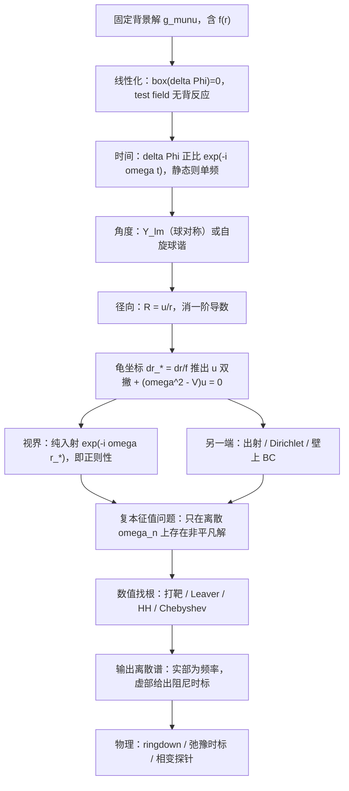

**本条定位**：回答 2026-10-26 的提问「我其实不是很懂 QNM 的具体流程，尝试概括一下你看看有没有错」。工作区级方法学入门，不属于任何单篇论文，故按 `agent.md` 第 1 节单独成篇，放在当前主攻的主题目录下。问答登记在根目录 `问答记录.md` 的 **Q8**。

---

## 0. 先给结论：你的概括骨架是对的，但有 4 处必须改

你写的是：

> 考虑在指定黑洞时空附近的标量场扰动，取这个扰动的径向部分，考虑 QNM 的视界和无穷远的边界条件，给出假设解带进方程化简，然后得到的是什么？

**对的**：分离变量 → 径向方程 → 两端边界条件 → 代回求解。这条链完全正确。

**要改的四处**：

| # | 你的表述 | 问题 | 正确说法 |
| --- | --- | --- | --- |
| 1 | "扰动**发生在哪**（近视界还是别处）" | QNM **不是**某个位置上的扰动 | QNM 是整个外部区域 $r_H<r<r_{\rm end}$ 上的**全局本征模**；"在哪"这个问法对它不适用（只有振幅包络有偏好位置） |
| 2 | "取径向部分（怎么取）" | 漏了两步 | 需要 ① $e^{-i\omega t}$ 的**时间傅里叶分解**（因为背景静态），② 径向函数要**除以 $r$**，否则拿不到薛定谔形式 |
| 3 | "视界和无穷远" | 只对渐近平坦成立 | AdS 是**有限 $r_*$ 的 Dirichlet（反射壁）**，dS 是**宇宙视界 outgoing**，腔是**壁上边界条件** |
| 4 | "带进方程化简，然后得到的是什么" | 得到的是**本征值条件**，不是"解" | 得到一个**复本征值问题**：只在离散的 $\omega_n\in\mathbb{C}$ 上存在非平凡解；必须**数值找根** |

另外**漏掉的第一步**：必须先做**线性化**（test field，忽略反作用）。

---

## 1. 第 0 步（你的流程里漏了）：背景 + 线性化

**背景**：一个固定（不演化）的黑洞解，例如

$$
ds^2=-f(r)\,dt^2+\frac{dr^2}{f(r)}+r^2\,d\Omega^2 .
$$

记 $f(r_H)=0$（视界），$f'$ 在 $r_H$ 有限且 $>0$（非极端）。

**线性化**：写 $\Phi=\Phi_0+\delta\Phi$，其中 $\Phi_0$ 是背景场（通常取 0），**只保留 $\delta\Phi$ 的一阶项**。对最小耦合无质量标量场，就是自由 Klein–Gordon 方程

$$
\Box\,\delta\Phi=0,
$$

即 $\frac{1}{\sqrt{-g}}\partial_\mu\!\left(\sqrt{-g}\,g^{\mu\nu}\partial_\nu \delta\Phi\right)=0$。

**为什么这一步必不可少**：QNM 是**线性微扰论**的概念。非线性阶段（并合瞬间、二阶模）不属于 QNM。所以严格说，只有时空"安静到可以用线性方程描述"之后，QNM 才成立——这也是观测侧 $t_{\rm start}$ 争议的根源（见 `准正规模QNM/观测资料/备注-QNM观测与ringdown谱学.md` 的 Q2）。

---

## 2. "扰动发生在哪？"——QNM 是全局概念

这是最容易误解的一点。

**一个 QNM 不是一个波包，而是一个本征函数**。它定义在整个外部区域：

$$
r_H<r<r_{\rm end},\qquad r_{\rm end}=\begin{cases}+\infty & \text{渐近平坦}\\ \text{AdS 边界（}r_*\text{ 有限）} & \text{AdS}\\ r_c\ \text{（宇宙视界）} & \text{dS}\\ R\ \text{（反射壁）} & \text{York 腔}\end{cases}
$$

它有**处处非零**的支撑，只不是均匀的：

- $\ell\ge 1$ 时，有效势 $V$ 在**光子球附近**（$r\approx 3M$）有一个峰，模函数的**包络**在那儿最大 → 直觉上"振荡主要发生在势垒附近"。
- $\ell=0$（s-wave）时离心项为零，峰更靠外、更平缓，模弥散得更开。
- 视界附近：模**纯入射**地向内坠（振幅按 $e^{-i\omega r_*}$）；远处：**纯出射**地向外逃。

**那"扰动"这个词指什么？** 指**初始数据**。你可以把一团波包扔在视界附近或远处——那是**初值问题**。QNM 是把这团波包按**本征模展开**之后剩下的一批"振铃"成分：

$$
\delta\Phi(t,r,\theta,\varphi)\;\simeq\;\sum_n A_n\,e^{-i\omega_n t}\,\psi_n(r)\,Y_{\ell m}(\theta,\varphi)\quad(t\to\infty)
$$

其中 $A_n$ 是**激发系数**（由初值决定），而 $\omega_n,\psi_n$ 由**本征值问题**决定。两者是完全不同的东西——这点后面第 8 节还会强调。

**尺度直觉**：QNM 频率只由"势垒形状 + 两端边界条件"决定，与波包细节无关。所以 $\omega_{220}M_f$ 对 Kerr 是个常数，LIGO 才能拿它做黑洞谱学。

---

## 3. "标量场扰动对应什么物理现象？"——五种读法，别混

同一个方程，在不同语境里代表完全不同的东西：

| 读法 | 标量场是什么 | QNM 的物理含义 | 典型场景 |
| --- | --- | --- | --- |
| **(a) 玩具模型** | 一个数学探针，无实际物质 | 用来**标定方法**；换成 $s=2$ 的引力扰动就得到真实 ringdown | `2606.29101`、绝大多数"QNM + 相变"文章 |
| **(b) 实际物质场** | 轴子、dilaton、或其他轻标量 | 该物质在黑洞外的**准束缚/衰减振荡** | 超辐射、黑洞 bomb、dark matter 环境 |
| **(c) 时空本身的振铃** | —（$s=2$ 张量扰动，Teukolsky） | **真正的引力波 ringdown**：$h(t)\propto e^{-i\omega t}$ | GW150914、GW250114 的谱学 |
| **(d) 对偶算符的弛豫** | 边界算符 $\mathcal{O}$ 的体对偶 | QNM $=$ 推迟格林函数 $\langle\mathcal{O}\mathcal{O}\rangle_{\rm ret}$ 的**极点**；$\omega_I^{-1}=$ 热化时标 | AdS/CFT、全息超导体 |
| **(e) 腔内驻波** | 腔内被多次反射的场 | 谱间距由**腔长**定，$\Delta\omega_R\approx\pi/D$ | 反射壁腔、近视界镜面（`2609.20382`） |

**关键提醒**：`2606.29101` 那类文章里，标量场**纯粹是温度计**——它不参与热力学（test field，无背反应），只是提供一个"能读数"的动力学通道。因此它们**只能**说"谱随控制参数怎么变"，**不能**说"标量场导致了相变"。

> 若要做真正的观测对接，必须换成 $s=2$ 的引力扰动（Regge–Wheeler / Zerilli，Kerr 用 Teukolsky）。标量与引力扰动的方程**同构**，只是有效势不同——这正是"用标量做玩具"合法的原因。

---

## 4. 「取径向部分」到底怎么取

### 4.1 时间方向：傅里叶分解

背景是**静态**的（$\partial_t$ 是 Killing 矢量），所以可以设单一频率：

$$
\delta\Phi(t,r,\theta,\varphi)=e^{-i\omega t}\,\phi(r,\theta,\varphi).
$$

- 注意：能量**不守恒**（视界吸收 + 无穷远辐射），但**静态性**足以让 $\omega$ 良定义。$\omega$ 将变成**复数**。
- 符号约定：本工作区统一用 $e^{-i\omega t}$，于是**稳定 $\iff\omega_I<0$**、**不稳定 $\iff\omega_I>0$**。

### 4.2 角度方向：球谐（或自旋球谐）

球对称背景用 $Y_{\ell m}$：

$$
\delta\Phi=\frac{u(r)}{r}\,e^{-i\omega t}\,Y_{\ell m}(\theta,\varphi).
$$

- 若不是球对称（Kerr），$Y_{\ell m}$ → **自旋加权扁球谐** ${}_sS_{\ell m}$，且 $\ell$ 不再严格整数标记（谱有 $\omega$ 依赖的分离常数）。
- 只有 $\ell\ge\vert m\vert$；对固定 $\ell$ 有 $2\ell+1$ 个 $m$，在球对称背景下**谱与 $m$ 无关**（简并）。

### 4.3 为什么必须除以 $r$（很多人漏这一步）

直接设 $\delta\Phi=R(r)Y_{\ell m}e^{-i\omega t}$ 会得到一个**带一阶导数**的方程：

$$
fR''+\left(f'+\frac{2f}{r}\right)R'+\left[\frac{\omega^2}{f}-\frac{\ell(\ell+1)}{r^2}\right]R=0 .
$$

令 $R=u/r$ 消掉一阶项，一步代数化简后得

$$
\boxed{\;u''+\frac{f'}{f}u'+\left[\frac{\omega^2}{f^2}-\frac{\ell(\ell+1)}{r^2 f}-\frac{f'}{rf}\right]u=0\;}
$$

### 4.4 龟坐标（tortoise）：变成薛定谔方程

定义 $dr_*=\dfrac{dr}{f(r)}$，即 $r_*=\int^r \frac{dr'}{f(r')}$。则 $\dfrac{d}{dr}=\dfrac{1}{f}\dfrac{d}{dr_*}$，上式**一阶项自动抵消**：

$$
\boxed{\;\frac{d^2u}{dr_*^2}+\Big[\omega^2-V(r)\Big]u=0\;}
$$

$$
V(r)=f(r)\left[\frac{\ell(\ell+1)}{r^2}+\frac{f'(r)}{r}+\mu^2\right]\qquad(s=0,\ \mu=\text{质量})
$$

对自旋 $s$（Schwarzschild，$2M$ 约定）可统一写成

$$
V_s(r)=f(r)\left[\frac{\ell(\ell+1)}{r^2}+\frac{(1-s^2)f'(r)}{r}\right],
$$

检验：$s=0$ 回到上式；$s=1$ 得 $V=f\ell(\ell+1)/r^2$（Regge–Wheeler 电磁）；$s=2$ 多出 $-3f'/r=-6M/r^3$（引力的离心势垒修正）。

**$r_*$ 的意义（这就是"两端"的来源）**：

| 渐近结构 | $r_*\to$ 视界处 | 另一端 |
| --- | --- | --- |
| 渐近平坦 | $-\infty$ | $r_*\to+\infty$（空间无穷远） |
| AdS | $-\infty$ | **有限值**（$\int^\infty dr/f$ 收敛）→ 这就是为什么 AdS 有"壁"、谱离散 |
| dS | $-\infty$（事件视界） | $r_*\to+\infty$（宇宙视界） |
| York 腔 | $-\infty$ | 有限值 $r_*(R)$ |

---

## 5. 边界条件：QNM 的定义所在

**QNM 的定义就一句话：两端都是"向外"的。**

| 位置 | 条件 | 理由 |
| --- | --- | --- |
| 事件视界 $r_*\to-\infty$ | **纯入射**：$u\propto e^{-i\omega r_*}$ | 经典视界不发光；换成 Kruskal 坐标要求解在该处**解析（正则）**，这只允许 $v=t+r_*$ 方向的波 |
| 渐近平坦 $r_*\to+\infty$ | **纯出射**：$u\propto e^{+i\omega r_*}$ | 不允许外面有入射辐射 |
| AdS 边界 | **Dirichlet / 可归一化** | 边界像镜子；能量不逃逸但被吸收到视界 |
| dS 宇宙视界 | **纯出射**（坐标反向） | 两个视界都只吸不放 |
| 反射壁 $r=R$ | **Dirichlet / Neumann / Robin** | 物理壁；具体取法见 `2108.04146`（Maxwell 有两套 Robin 条件，会给出两族谱） |

**为什么这个条件让问题变难**：

1. **非自伴**。吸收边界 ⇒ 演化算子耗散 ⇒ 本征值必然**复数**，本征函数**不正交**。这不是技术细节：它是"QNM 展开不完备""存在瞬态增长（transient growth）"的根源——也就是 `2507.16493` 那篇伪谱综述的主题。
2. **边界条件依赖 $\omega$ 本身**（因为 $e^{\pm i\omega r_*}$ 里就有 $\omega$）。所以**不能**把它写成"给定 $A$，求 $A u=\lambda u$"的常规范式——这就是为什么几乎所有 QNM 都要**数值找根**（第 7 节）。
3. **视界处的正则性**要用 Frobenius 展开给出：$u\sim (r-r_H)^{s_1}$，指标方程解出 $s_1=\pm i\omega/f'(r_H)$；纯入射选其中一个。

---

## 6. 数学上到底在解什么：**复本征值问题**

整理一下：设好分离变量、换成 $u(r_*)$ 后，问题是

$$\left[\frac{d^2}{dr_*^2}+\omega^2-V(r)\right]u=0,\qquad
u\sim\begin{cases}e^{-i\omega r_*}, & r_*\to-\infty\\ e^{+i\omega r_*}\ \text{或 Dirichlet}, & r_*\to+\infty\end{cases}$$

**这是一道"带辐射边界条件的本征值问题"**（$\omega$-dependent BC 的 Sturm–Liouville 型问题）。它的解集是：

$$
\{\omega_n\}_{n=0}^{\infty}\subset\mathbb{C},\qquad \omega_n=\omega_{n,R}+i\,\omega_{n,I}
$$

> ⚠ **注意“解集”到底指什么**：解集不是一个数列，而是**数 + 函数**的配对 $\{(\omega_n,\psi_n(r))\}$。$\omega_n$ 是与 $r$ 无关的复数，$\psi_n(r)$ 才是 $r$ 的函数。**$r$ 不是参数，是自变量**；那“这些数由什么给定”见文末 **Q1**。

- $\omega_{n,R}$：振荡频率（周期 $2\pi/\omega_R$）
- $\omega_{n,I}$：阻尼率；**衰减时标** $\tau_n=1/\vert\omega_{n,I}\vert$
- $n=0$ 叫**基频**（fundamental / lowest），$n\ge1$ 叫**高阶模**（overtones）。基频**不一定**是衰减最慢的那个——高 $\ell$ 的模常常更长寿。
- 整体振幅**自由**：本征值条件只固定 $\omega$，不固定幅度。要定幅度必须算**激发系数** $A_n$（第 8 节）。

**eikonal 极限（$\ell\gg1$）下的解析对照**——这条极重要，因为它是"QNM ↔ 几何"的唯一硬连接：

$$
\omega_n\approx\Omega_{\rm ph}\,\ell-i\,\lambda_{\rm Lyap}\left(n+\tfrac12\right)
$$

其中 $\Omega_{\rm ph}$ 是光子球上的轨道角速度、$\lambda_{\rm Lyap}$ 是光子球处不稳定零测地线的 Lyapunov 指数。⇒ **高 $\ell$ 的 QNM 就是"绕光子球转的零测地线"的波动版本**。`1909.11911` 正是靠这个把热力学与 QNM 的关系写成了等式。

---

## 7. 数值上怎么找根（四种主流算法）

因为 BC 含 $\omega$，标准做法都是"把 $\omega$ 当未知数、把失配当残差"：

| 方法 | 做法 | 适用 | 代价 |
| --- | --- | --- | --- |
| **打靶 (shooting)** | 视界处用 Frobenius 定初值 → 向外积分；远处与出射渐近展开匹配；残差 $D(\omega)$ 在 $\mathbb{C}$ 上求根 | 通用 | 高 $\vert\omega_I\vert$ 时数值爆炸（本工作区实测过） |
| **Leaver 连分数** | 解写成三阶递推，收敛条件给出关于 $\omega$ 的方程，求根 | 平坦 / Kerr（Schwarzschild 类） | 需处理收敛层级 |
| **Horowitz–Hubeny** | AdS：视界处幂级数展开 + 边界 Dirichlet 在截断处 → 行列式条件 | AdS | 截断敏感 |
| **Chebyshev 谱配置** | 直接离散成**广义本征值问题** $A\vec u=\omega B\vec u$，一次给出全部谱 | 通用，尤其腔/AdS | 有伪模，需**行缩放** + 收敛判据（本工作区已跑通，见 `/memories/repo/工具与流程.md`） |

**WKB / eikonal** 只是近似（$\ell\gg1$），不给低阶模。

---

## 8. 三条必须记住的"坑"（也是文献里最容易出错的地方）

1. **QNM 不构成完备正交基。** 由于非自伴，$\sum_n A_n e^{-i\omega_n t}\psi_n$ 只是**渐近**展开；渐近平坦时晚期的真实行为是**幂律尾**（来自连续谱的支割），不是指数衰减。所以"只留 QNM"是一个物理近似，不是恒等式。
2. **本征值不含信息"可见性"。** 算出一个 $\omega_n$ ≠ 观测上看得见它：振幅 $A_n$ 与起振时间都在本征值之外。这也是 overtone 争议的技术根源。
3. **"符号约定"必须自洽。** 用 $e^{-i\omega t}$ 时：$e^{-i\omega r_*}$ 是入射、$e^{+i\omega r_*}$ 是出射、$\omega_I<0$ 为稳定。换个约定就全部反号——**跨文献抄数值前先确认约定**（本文献里 `2606.29101` 用 $e^{-i\omega t}$，$\omega_I<0$ 稳定）。

---

## 9. 流程图

---

## 10. 把 `2606.29101` 放进这个骨架里（对照检查）

| 流程步骤 | 该文做了什么 | 备注 |
| --- | --- | --- |
| 背景 | 4D Einstein + 弱非线性电动力学，$f=1-\frac{m}{r}+\frac{r^2}{l^2}+\frac{q^2}{r^2}-\frac{2q^4\alpha}{5r^6}$，固定 $l=10,\alpha=0.12$ | AdS |
| 线性化 | 无质量标量，$\Box\Phi=0$ | 玩具模型（读法 a） |
| 时间 | $e^{-i\omega t}$ | 与本文约定一致 |
| 角度 | **只取 $\ell=0$** | 其 Eq.(18) 无离心项；文中仍写 $Y(\theta,\phi)$，属表述不严 |
| 径向 | 变换后的方程 (21) | **该项系数有笔误**：$-\frac{2i\omega^2}{rf}$ 应为 $-\frac{2i\omega}{rf}$（量纲 $L^{-3}$ vs $L^{-2}$） |
| 视界 | 纯入射 | — |
| 另一端 | **AdS 边界 Dirichlet** | 不是"无穷远出射" |
| 求解 | 打靶法 | 表 I/II 的数值本工作区复核过：趋势一致，绝对值差 2–4%（$\omega_R$）、14–24%（$\vert\omega_I\vert$），且**本工作区自己的复核未收敛** ⇒ 不宜把表值当基准引用 |
| 输出 | 小/大/中间三相的 $\omega$ | 结论：三相谱可分；0 阶相变处也有变化 |

---

## 11. 回到主题：为什么"QNM 探相变"就是看这个谱

既然 $\{\omega_n\}$ 只由「$V$ 的形状 + 两端 BC」决定，而 $V$ 又由背景 $f(r)$ 决定，那么：

> **热力学相变 = $f(r)$ 所允许的两族不同背景（小/大黑洞）= 两个不同的 $V$ = 两套不同的谱。**

于是"用 QNM 探相变"在逻辑上是自洽的。但要注意两点，这是 `总览` 第 3 节判据强度的来源：

1. **两支 Background 本来就不同**，谱当然不同——"斜率不同"几乎必然成立，**不构成证据**。真正有意义的是在**同温度同压力的共存线**上比较（两相可共存，$f$ 的差别纯粹来自相）。
2. **临界点上两支应当合并**，所以"临界点处斜率差异大"在逻辑上是自相矛盾的；这也正是多篇文章报告"临界点反而看不到信号"的原因。

---

## 12. 一句话总结

> QNM = 在**静态黑洞背景**上，对一个**线性测试场**做分离变量，得到**带辐射边界条件的复本征值问题**；解出来的是**离散的复频率谱** $\{\omega_n\}$（实部 = 振荡，虚部 = 阻尼），而不是"一个解"。谱由势垒形状与两端边界条件唯一决定——因此它才可能携带背景（也就是热力学状态）的信息。

---

## 问答记录

### Q1. 解集的具体数值是由 $r$ 给定的吗？（2026-10-26）

**问题**：也就是说最后得到的是一个解集，这个解集的具体数值由 $r$ 给定？

**解答**：**不是。$r$ 是自变量，不是参数。**

#### 1. 先分清"解集"里装了两样东西

$$
\text{解集}=\big\{(\omega_n,\ \psi_n(r))\big\}_{n=0}^{\infty}
$$

| 对象 | 是什么 | 依赖 $r$ 吗 |
| --- | --- | --- |
| $\omega_n$ | 一个**复数**（$n=0,1,2,\dots$） | **不依赖**。它是待定的本征值，不是 $r$ 的函数 |
| $\psi_n(r)$ | 一个**函数** | 依赖；$r$ 从 $r_H$ 到另一端取值 |

所以"\(\omega\) 随 $r$ 变"这句话在数学上是**没有定义**的：在同一个背景里，$r$ 只是坐标。

#### 2. 那些数到底由什么定下来

$$
\omega_n=\omega_n\Big(\underbrace{\text{背景的无量纲参数}}_{\text{形状}},\ \underbrace{\ell,m,n}_{\text{量子数}},\ \underbrace{\text{两端 BC}}_{\text{含壁位置/反射率}},\ \underbrace{s,\mu}_{\text{场}}\Big)
$$

- **背景形状**：$f(r)$ 里的参数。但只有**无量纲组合**进去（见下表）。
- **量子数**：$\ell$（角动量）、$m$（球对称时简并）、$n$（第几个模）。这就是"离散"的标签来源。
- **边界条件**：AdS 边界、dS 宇宙视界、反射壁位置 $R$ 与反射率 $\mathcal{R}$ 都直接改谱。**壁的位置 $R$ 是一个"特征半径"**，它确实是一个长度参数——但注意它是**边界的位置**，不是"你在哪个 $r$ 上观测"。
- **场**：$s$（自旋，改有效势）、$\mu$（质量）。

#### 3. 为什么必然离散（$\omega$ 是"要去凑的那个数"）

二阶 ODE 只有两个积分常数：视界正则性吃掉一个，整体归一化吃掉另一个（振幅自由）。于是剩下来的**唯一**约束就是远端的那个条件。而远端条件（纯出射 / Dirichlet）是**关于 $\omega$ 的解析方程**，它的零点是**孤立的** ⇒ 只有离散的几个 $\omega$ 能让两端同时满足。

一句话：**$\omega$ 不是被"给定"的，而是被"求解出来"的**——它是让两个边界条件不矛盾的那个特殊值。

#### 4. 一个能立刻杀死"$\omega$ 由 $r$ 定"的例子：Schwarzschild 的尺度不变性

Schwarzschild 只有**一个**长度尺度 $M$。于是方程在 $r\to \lambda r$、$M\to\lambda M$、$\omega\to\omega/\lambda$ 下不变 ⇒ **$\omega_n M$ 是纯数字**，只依赖 $(\ell,n,s,\mu M)$：

$$
\omega_n M=\underbrace{0.2929-0.0977\,i}_{\ell=1,\,n=0},\quad \underbrace{0.4836-0.0968\,i}_{\ell=2,\,n=0},\ \dots
$$

这些数**没有任何旋钮可拧**。这也正是 `gr-qc/0512160`（BCW）那张表能当"通用基准"的原因：换一个质量更大的 Schwarzschild，谱只是整体缩放到 $\omega\propto1/M$。

⇒ **要"拧旋钮"，必须至少多一个独立尺度**：$Q$（RN）、$\Lambda$（AdS/dS）、$R$（腔）、$\mu$（有质量场）。

| 模型 | $f(r)$ | 可拧的无量纲参数 | 谱怎么动 |
| --- | --- | --- | --- |
| Schwarzschild | $1-\frac{2M}{r}$ | **没有** | 只 $\propto 1/M$；$\omega M$ 是常数表 |
| RN | $1-\frac{2M}{r}+\frac{Q^2}{r^2}$ | $Q/M$ | 随 $Q/M$ 平滑移动（谱在极端附近的行为依赖扇区，不宜泛论） |
| RN-AdS | 上面再加 $\frac{r^2}{L^2}$ | $Q/M$ 与 $r_H/L$ | 两支（小/大黑洞）各走一条曲线 |
| 腔（York） | $1-\frac{2M}{r}$ + 壁在 $R$ | $r_H/R$ | 随腔长变；$\Delta\omega_R\sim\pi/D$ |
| Kerr | — | $a/M$ | $\ell,m$ 简并解除 |

#### 5. $r$ 真正进入的三处（这就是混淆的来源）

1. **作为 $\psi_n$ 的定义域**：$r$ 从 $r_H$ 走到另一端。这是"自变量"的唯一角色。
2. **作为特征半径进入边界条件**：$r_H$、$R$、$r_c$、AdS 边界。**但它们不是自由参数**——$r_H$ 由 $(M,Q,\Lambda)$ 反解出来。所以在给定背景里，这些数也是固定的。
3. **文献里的 $\omega(r_H)$ 曲线**：例如 `1405.2644` 画的 "$\omega$ vs $r_H$"。**这不是"$\omega$ 依赖坐标 $r$"，而是"$\omega$ 依赖你选的是哪个黑洞"**——$r_H$ 只是用来给**一族背景**编号的标签。换 $r_H$ ⟺ 换质量/电荷（在固定 $\Lambda$ 时就换 $T$）。
   > 这张"曲线"落到具体一张表上是什么样子、每一行怎么算出来，见 `准正规模QNM/arXiv-2606.29101v2/备注-QNM作为重入相变探针.md` 的 **Q3**（附完整的六步复现流程与对“跳变”一词的澄清）。

> 这个区别很实用：相变探针文献里的判据是 $\mathrm{d}\omega/\mathrm{d}r_H$ 的斜率，它衡量的是 **"沿一族黑洞走时谱怎么变"**，而不是"在某一个黑洞里 $\omega$ 随位置变"。这也正是 `总览` 第 3 节说"两支斜率不同几乎必然成立、不构成证据"的原因——两支 $r_H$ 本来就差一个量级，而 $\omega\propto1/r_H$ 量级上的差异谈不上相变信号。

**一句话**：$\omega_n$ 是**数**、由背景形状 + 量子数 + 边界条件定；$\psi_n(r)$ 才是**$r$ 的函数**。$r$ 唯一的"参数"身份是**边界位置的坐标**（$r_H$、$R$、$r_c$），而那些又都由物理参数决定，不独立。

**本条定位**：展开本文第 6 节「解集」一词的确切含义；同属工作区方法学问答（`问答记录.md` Q8 的追问）。
