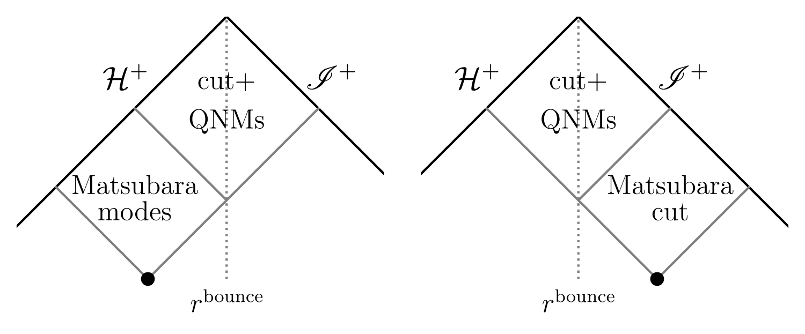
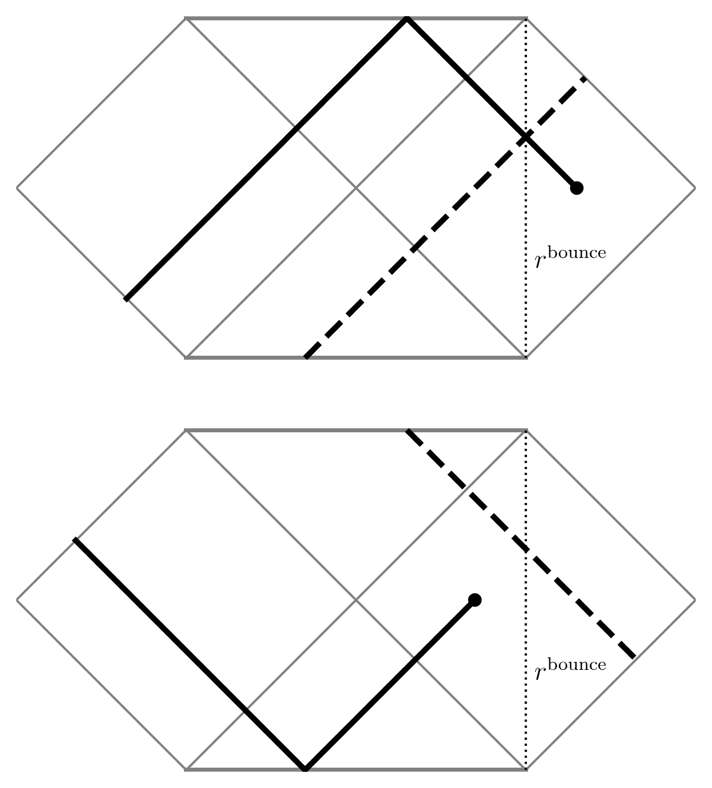
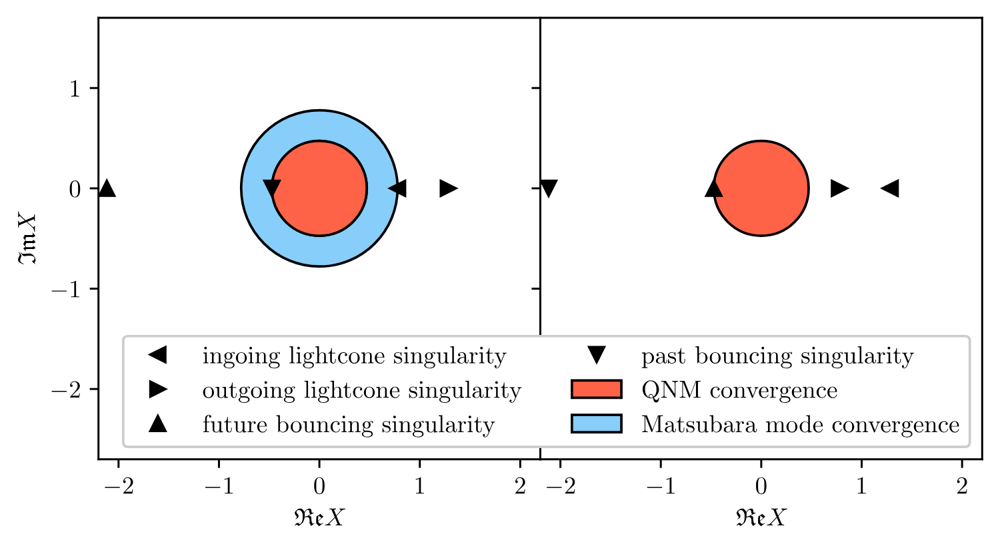

> **原文**：Paolo Arnaudo、Benjamin Withers，*Bouncing singularities in Schwarzschild: a geometric origin of the QNM convergence region*，arXiv:2605.16489v2 [gr-qc, hep-th]（v1 2026-05-15；v2 2026-06-10，minor revision；10 页 3 图；许可 CC BY 4.0）。
> **作者单位**：University of Southampton，Mathematical Sciences and STAG Research Centre（Highfield, Southampton SO17 1BJ, UK）。E-mail：`p.arnaudo@soton.ac.uk`、`b.s.withers@soton.ac.uk`。
> **本文件**：该文的中文译文（讲人话版）。公式编号与原文一一对应，正文里写成 `(n)` 的编号就是原 PDF 里的编号，便于回原文核对；QNM、Green's function、lightcone、null geodesic、singularity、bouncing singularity、Matsubara、tortoise coordinate、Kruskal–Szekeres、Wronskian、confluent Heun、prepotential、instanton、ringdown 等专业名词一律保留英文。原文 PDF 与 HTML 同在本目录，插图在 `Figs/`。

---

## 0 先讲人话：这篇到底在说什么

三句话：

1. 黑洞扰动在**晚期**可以写成「QNM 求和」加「branch cut 那一坨」。QNM 求和不是无条件收敛的，它只在一个区域里收敛——本文要回答的就是：**这个收敛域是谁定的？**
2. 前作 (Arnaudo–Carballo–Withers, [2510.18956](https://arxiv.org/abs/2510.18956)) 已经在数学上算出了这个边界：它是从某个半径 $r^\text{bounce}$ 散射出来的 lightcone，而且 $r^\text{bounce}$ 的数值恰好是 $2M(1+W_0(1/e))\approx 2.56M$ 这种"看着毫无意义"的点——不是 potential 的峰，也不是 light ring。**物理上它凭什么特殊？**
3. 本文的答案是：**complex time 平面上有个 singularity，它的位置正好对应 $r^\text{bounce}$**。这个 singularity 不来自任何真实的时空点，而是来自一条「撞到黑洞 singularity 上又弹回来」的 null geodesic——AdS/CFT 文献里管这叫 **bouncing singularity**。同一批 singularities 还顺带解释了近视界 Matsubara 模求和为什么有个**环状**收敛区。

全文的逻辑链（讲人话）：

| 步骤 | 干什么 | 在哪 |
| --- | --- | --- |
| ① | 摆出 Schwarzschild 线性扰动的老一套定义：radial equation、$\phi_\text{in}/\phi_\text{up}$、$\widetilde G_R$ | §2，(10)–(16) |
| ② | 说明 Schwarzschild 里存在 **bouncing geodesics**：径向 spacelike geodesic 在 $E\to\infty$ 时 turning point 掉进 $r=0$，极限下变成一条"断成两截"的 null 曲线，顶点在 singularity 上 | §3，(17)–(24) |
| ③ | 沿这条 bouncing null geodesic 传播 singularity，得到 complex $t$ 上的 bouncing singularity (8)(9) | §4 |
| ④ | 把 $G_R$ 看成 $X=e^{-\frac{2\pi}{\beta}t}$ 的幂级数，收敛半径由离 $X=0$ 最近的 singularity 决定；最近的恰好是 **bouncing** 那种，落在 $X<0$（即 complex $t$） | §4，(25)–(37) |
| ⑤ | $X<0$ 的 singularity 投回真实时空（$X>0$）时，正好给出从 $r^\text{bounce}_*=C$ 散射的 null ray——这就是前作收敛域边界的来源 | §4，(36) |
| ⑥ | 同样的 singularities 把 Matsubara 模求和的收敛区夹成一个**环**（内外半径各由一个 singularity 定） | §5，(42)–(57) |

一个容易误解的点先讲清：**bouncing singularity 不是真实时空里的 singularity**（黑洞里本来就有个 $r=0$ 的，但那不是它）。它是把 retarded Green's function 解析延拓到 complex $t$ 之后才冒出来的 singularity；它本身"不存在"，但它管着真实时空里 QNM 展开能收敛到哪。

---

## 摘要

我们用解析方法证明：Schwarzschild 时空 retarded Green's function 的 QNM 展开，其收敛性是由 **complex time 平面上的一个 singularity** 决定的。这个 singularity 有个很朴素的几何来历：它是 AdS/CFT 文献里所谓 "bouncing singularity" 的一个例子，成因是一条**从黑洞 singularity 上弹回来的 null geodesic**。我们的工作解释了为什么真实时刻上的 QNM 收敛域会被一条 null ray 卡住——这条 ray 是从引力 potential 上一个看起来平平无奇的点（按前作约定即 $r_*=0$）散射出来的——因为这条 ray 到原点的距离，恰好等于 relevant complex plane 里那个 bouncing singularity 到原点的距离。同一批 singularities 还负责另一件事：描述近视界扰动早期行为的 **Matsubara 模求和**，其收敛域是一个**环带**（annulus），也是被它们夹出来的。

---

## 1 引言

随着引力波天文的进展，理论上精确掌控黑洞 ringdown 行为越来越重要。事实上，通过迄今最响的事例 GW250114，人们已经能约束 remnant 黑洞最初几个 QNM [LVKloud]，这也说明 black hole spectroscopy 这个方向越来越有分量 [Berti:2025hly]。

本文重新审视 Schwarzschild 黑洞线性扰动的 retarded Green's function $G_R$。固定 spin $s$ 与角量子数 $m,\ell$，在足够晚的时刻，Green's function 可以写成「一个 branch cut 贡献」加「一个收敛的 QNM 求和」。把 QNM 那部分写成

$$G^\text{QNM}_R(t, t', r, r') = \sum_{n=0}^\infty c_n(r,r') e^{-i\omega_n (t-t')}, \tag{1}$$

本文要回答的问题就一句话：**是什么物理要素决定了 (1) 这个 QNM 求和的收敛域？**

$G_R$ 的完整分解在我们的前作 [Arnaudo:2025uos]（arXiv:2510.18956）里给出过，那是对 [Leaver] 那个开创性谱分解的推广——Leaver 的分解在早期时刻会发散。为了解决这一点，我们的构造说明：必须把 Green's function 拆成好几块，并配上一套 contour prescription（围道取法）。相关的早期工作见 [Andersson:1996cm]。而**围道怎么取，取决于如何按时空区域分块**；分块的界线是 Green's function 的 lightcone 在某个特定半径 $r^\text{bounce}$ 上被黑洞 potential 散射这件事。[^1] 整个分解示意在图 1。所以给定 $t', r'$，$r^\text{bounce}$ 就决定了 (1) 的收敛域。

[^1]: 与此同时，[Kuntz:2025gdq] 对 Pöschl-Teller potential 的扰动给出了一个类似的构造。

*图 1（原文 FIG. 1）：[Arnaudo:2025uos] 的谱分解在 Schwarzschild 时的样子。黑点 = retarded Green's function 的 delta function 源；它的谱分解取哪一套，取决于源落在时空的哪个区域（如图）。区域由半径 $r=r^\text{bounce}$ 划开，那里 lightcone 被 potential 散射，$r^\text{bounce}$ 由 (2) 给出。本文的目标就是解释这个位置为什么特殊。*

$r^\text{bounce}$ 的数值最早是在 [Arnaudo:2025uos] 里用 Heun connection coefficients 的 instanton 展开估出来的；在我们的姊妹篇 [Arnaudo:2025kit]（arXiv:2511.17703，*Price's law from quasinormal modes*）里，直接对 branch cut 那部分做收敛性分析把它算准了，得到

$$r^\text{bounce} = 2M\left(1 + W_0\left(1/e\right)\right), \tag{2}$$

其中 $W_k(z)$ 是 Lambert W 函数。这个结果与后续几项近似数值工作 [Su:2026fvj, Ma:2026qbq] 看到的收敛行为一致。[^2]

[^2]: 另见 [DeAmicis:2025xuh]，那篇也考察 QNM 收敛域，但结论不同。

写成更紧凑的形式：用 tortoise coordinate

$$r_* = r + 2M \log\left(\frac{r}{2M}-1\right) + C, \tag{3}$$

其中 $C$ 是任意积分常数，则弹跳半径 (2) 就是

$$r^\text{bounce}_* = C. \tag{4}$$

按前作的约定，积分常数取 $C=0$，于是大家就用 $r^\text{bounce}_* = 0$ 当简写。为了让话说清楚，本文**始终保留 $C$ 为任意**。物理量当然不依赖这个任意常数 $C$，所以我们会看到，凡是物理量里出现 $r_*$，它都是以 $r_*-C$ 的组合出现。

本文要处理的关键别扭之处是：(2)/(4) 看上去不对应任何"有物理意义"的位置。比如它既不是 potential 的峰，也不是 light ring。我们要证明的是：尽管数值上很奇怪，这个位置**有它自己的几何地位**。一个提示来自 Kruskal–Szekeres 坐标：

$$U=-e^{-\frac{t-r_*}{4M}},\qquad V=e^{\frac{t+r_*}{4M}}. \tag{5}$$

在这套坐标下，黑洞 singularity $r=0$ 的位置是

$$UV=e^{\frac{C}{2M}}, \tag{6}$$

而弹跳位置 (2) 对应的是 (6) 在 Kruskal 平面上**关于原点做个反射**：

$$UV=-e^{\frac{C}{2M}}. \tag{7}$$

这已经在暗示 (2) 背后有更深的几何。

确实如此。我们证明 (2) 的真正来源是几何的：它是 complex $t$ 平面上一对所谓的 **bouncing singularities**：

$$-t+r_*+t'+r_*' = 2C+i\beta\left(n-\frac{1}{2}\right),\quad \text{(future)} \tag{8}$$

$$t+r_*-t'+r_*' = 2C+i\beta\left(n-\frac{1}{2}\right), \quad \text{(past)} \tag{9}$$

其中 $n\in\mathbb Z$，$C$ 就是 (3) 里的积分常数，$\beta = 8\pi M$ 是黑洞 Hawking 温度的倒数。这些 singularities 之所以出现，是因为它们是时空里这样一些位置：从 $t',r'$ 出发，可以沿着一条 null geodesic 走到它们那里，而这条 geodesic 会从未来／过去的黑洞 singularity 上**弹一下**。bouncing singularity 这个概念是从 AdS/CFT 文献搬过来的：在那里它出现在热 correlator 的解析延拓中 [Fidkowski:2003nf, Festuccia:2005pi]，最近相当受关注 [Parisini:2023nbd, Ceplak:2024bja, Buric:2025anb, Barrat:2025nvu, Buric:2025fye, Barrat:2025twb, Afkhami-Jeddi:2025wra, Dodelson:2025jff, Ceplak:2025dds, Jia:2025jbi, Arnaudo:2026der, Grozdanov:2026cut, Jia:2026ryl]。

我们证明：(8)、(9) 这对 bouncing singularities 决定了 QNM 求和 (1) 的**收敛半径**。具体哪一个起作用，看 $r_*'$ 落在哪边：若 $r_*' > C$，则由 (8)（future）决定；若 $r_*' < C$，则由 (9)（past）决定。这些 singularities 并不出现在物理时空里，但它们**决定了物理时空中 QNM 求和的收敛域**。收敛域的边界，恰好就是 retarded Green's function 的 lightcone 在 (2) 那个半径上被 potential 散射出来的那条 null ray——至此主结果成立。

除了 QNM 求和，同一批 singularities 还负责另一件事：近视界的 Matsubara 模求和的收敛域（图 1 左图那种情形）。在那里，Matsubara 模求和是一个 **Laurent 级数**，收敛域是个**环带**，环带内外两个边界各对应一个 singularity：一个是 (9)（past bouncing），另一个是 lightcone singularity 的 ingoing 那一支。我们显式地把 Matsubara 模渐近求和，得到的函数恰好带这两个 singularity。

下文结构：先给 Schwarzschild spin-$s$ 线性扰动与 retarded Green's function 的定义和约定；然后说明 Schwarzschild 时空里 bouncing geodesics 的存在性；再说明它们如何对应到 complex time 上的 singularities (8)(9)，以及如何决定 QNM 收敛半径；最后说明早期、近视界的 Matsubara 模分解，其收敛域是个环带，也被这些 singularities 夹住。

---

## 2 Schwarzschild 扰动与径向 Green 函数

（这一节就是把标准记号摆清楚，没有新东西。）

考虑四维 Schwarzschild 黑洞周围的一类无质量线性扰动，spin 记为 $s$：

$$ds^2=-f(r)\,\mathrm{d}t^2+\frac{\mathrm{d}r^2}{f(r)}+r^2\,\mathrm{d}\Omega_2^2, \qquad f(r)=1-\frac{2M}{r}, \tag{10}$$

spin 标签 $s=0,1,2$ 分别对应标量、电磁、以及 vector 型（Regge–Wheeler）引力扰动。把它们按 Fourier 模分解：

$$\Phi(t,r,\theta,\varphi)=\int \mathrm{d}\omega\sum_{\ell,m}e^{-i\omega t}Y_{\ell m}(\theta,\varphi)\frac{\phi(r)}{r}. \tag{11}$$

得到的 radial equation 是

$$\phi''(r)+\frac{f'(r)}{f(r)}\phi'(r)+\frac{\omega^2-V_s(r)}{f(r)^2}\phi(r)=0, \tag{12}$$

potential 为

$$V_s(r)=f(r)\left[\frac{\ell(\ell+1)}{r^2}+(1-s^2)\frac{2M}{r^3}\right]. \tag{13}$$

记 $\phi_{\text{in}}$ 为在 future horizon 上 ingoing 的解，$\phi_{\text{up}}$ 为在 future null infinity 上 outgoing 的解：

$$\phi_{\text{in}}(r)\sim e^{-i\omega r_*}\ (r\to 2M),\qquad \phi_{\text{up}}(r)\sim e^{i\omega r_*}\ (r\to\infty). \tag{14}$$

用这两个齐次解，频率域的 retarded Green's function 是

$$\widetilde{G}_R(\omega, r, r') = \frac{1}{\mathcal{W}} \times

\begin{cases}

\phi_\text{in}(r) \, \phi_\text{up}(r'), & r < r' \\

\phi_\text{in}(r') \, \phi_\text{up}(r), & r > r',

\end{cases} \tag{15}$$

其中 Wronskian $\mathcal{W} = \phi_\text{up} \partial_{r_\ast}\phi_\text{in} - \phi_\text{in} \partial_{r_\ast}\phi_\text{up}$。最后，我们要的时域 retarded Green's function 就是做 Fourier 变换：

$$G_R(t,t', r, r') = \int_{-\infty}^\infty \frac{d\omega}{2\pi} \widetilde{G}_R(\omega, r, r') e^{-i \omega (t-t')}, \tag{16}$$

怎么把这个积分算出来，正是我们前作谱分解那篇 [Arnaudo:2025uos] 的主题。

---

## 3 弹跳测地线（Bouncing geodesics）

本节的核心对象是 Schwarzschild 时空里所谓的 **bouncing geodesics**。它们是**连接最大延拓 Schwarzschild 时空两个外部区域的 spacelike geodesics 的一个极限**。在这个极限下，geodesic 变成 null，并且从黑洞 singularity 上弹开——要么弹向未来，要么弹向过去。见图 2。

*图 2（原文 FIG. 2）：Schwarzschild 时空里的 bouncing geodesics。取一条从右侧外部区域某点（黑点）出发、沿径向朝内的 spacelike geodesic；在能量很大的极限下它变成 null 并从 singularity 上弹开（黑色实线），可以弹向未来（**上图**）或弹向过去（**下图**）。黑色虚线是对应的 null geodesic，其 $|X|=\left|e^{-\frac{2\pi}{\beta}t}\right|$ 与弹跳之后的 geodesic 相同。*

用仿射参数 $\lambda$ 参数化一条径向 spacelike geodesic $x^\mu(\lambda)=(t(\lambda),r(\lambda))$，它满足

$$-f(r)\dot{t}^2+\frac{\dot{r}^2}{f(r)}=1, \tag{17}$$

点号表示对 $\lambda$ 求导。因为 $\partial_t$ 是 Killing vector，

$$E=f(r)\dot{t} \tag{18}$$

沿 geodesic 守恒。把 $\dot{t}=E/f(r)$ 代回 (17) 得

$$\dot{r}^2=E^2+f(r)=E^2+1-\frac{2M}{r}. \tag{19}$$

turning point 由 $\dot{r} = 0$ 定出：

$$r_{\min}(E) = \frac{2M}{1+E^2}. \tag{20}$$

立刻可以读出

$$r_{\min}(E) \to 0\qquad\text{as}\qquad E \to \infty. \tag{21}$$

也就是说：这族连接两个外部区域的径向 spacelike geodesics，其 turning point 随着能量变大**一路逼近 Schwarzschild singularity**。

在离开 turning point 的地方，

$$\frac{\mathrm{d}t}{\mathrm{d}r}=\frac{\dot{t}}{\dot{r}}=\pm\frac{E}{f(r)\sqrt{E^2+f(r)}}=\pm\frac{1}{f(r)}+O(E^{-2}), \tag{22}$$

用的是 (18) 和 (19)。所以每个分支在 $E\to\infty$ 极限下都变成一条径向 null 曲线：

$$\frac{\mathrm{d}t}{\mathrm{d}r}=\pm\frac{1}{f(r)}. \tag{23}$$

用 tortoise coordinate (3) 写出来，这些 null 曲线就是

$$u=t-r_*=\mathrm{const},\qquad v=t+r_*=\mathrm{const}. \tag{24}$$

所以极限下的对象是一条**折断的径向 null 曲线**：一段是 $v=\mathrm{const}$，一段是 $u=\mathrm{const}$，顶点落在 singularity $r=0$ 上。这就是"弹跳"的图景：null ray 扎进 singularity，然后从 singularity 上被"反弹"出来。

---

## 4 QNM 收敛性

现在来推 QNM 收敛域。考虑 retarded Green's function 里被写成 QNM residue 求和 (1) 的那部分。在高 overtone 数下 [Motl:2002hd, Berti:2009kk]

$$\omega_n\sim -i\frac{2\pi}{\beta} n +\mathcal{O}\left(n^0\right), \qquad n\to \infty. \tag{25}$$

$n$ 的高阶次领头修正不影响 residue 求和的收敛半径，所以我们可以只看"系数取 (1) 中系数的渐近行为"的那个级数。引入

$$X=e^{-\frac{2\pi}{\beta}t}, \tag{26}$$

收敛性问题于是化简为：研究一个关于 $X$ 的幂级数，其收敛半径由（解析延拓后的）$G_R$ 在 complex $X$ 平面上**离 $X=0$ 最近的 singularity** 决定。

$G_R$ 的 lightcone singularities 由 Hadamard 那套"singularity 沿光滑 null geodesic 传播"的结论管 [hadamard, Duistermaat1972, Friedlander1975, Hormander1987]（Schwarzschild 语境下的处理见 [Casals:2016qyj]，AdS/CFT 语境下最近的讨论见 [Grozdanov:2026cut]）。而近年 AdS/CFT 的工作提示：**spacelike geodesics 的折断 null 极限（也就是上一节那些 bouncing geodesics）也算在内**。它们把 singularity 送到 complex $t$ 上——也就是把 Fourier 积分 (16) 解析延拓到 $t\in\mathbb C$ 之后才看得到的 bouncing singularity。

为了把这些点换算到 $X$ 上，先固定右侧外部区域里的一点

$$p_R = (U_R,V_R) \in I,\qquad (U_R<0, V_R>0). \tag{27}$$

从 $p_R$ 出发的 ingoing 径向 null 分支是直线

$$V = V_R. \tag{28}$$

它与未来 singularity (6) 的交点由下式定出：

$$U_b V_b = e^{\frac{C}{2M}},\qquad V_b = V_R, \tag{29}$$

于是弹回来的那条 light ray 是

$$U = \frac{e^{\frac{C}{2M}}}{V_R}. \tag{30}$$

同理，也可以考虑过去指向的 lightcone，从**过去** singularity 上弹回来：

$$V = \frac{e^{\frac{C}{2M}}}{U_R}. \tag{31}$$

所以总共四个 singularity 位置：

$$U = U_R \;\implies\; X = e^{-\frac{2\pi}\beta\left(t'+r_*-r_*'\right)} \tag{32}$$

$$V = V_R \;\implies\; X = e^{-\frac{2\pi}\beta\left(t'-r_*+r_*'\right)} \tag{33}$$

$$U = \frac{e^{\frac{C}{2M}}}{V_R} \;\implies\; X = -e^{-\frac{2\pi}\beta\left(t'+r_*+r_*'-2C\right)} \tag{34}$$

$$V = \frac{e^{\frac{C}{2M}}}{U_R} \;\implies\; X = -e^{-\frac{2\pi}\beta\left(t'-r_*-r_*'+2C\right)} \tag{35}$$

依次是：**ingoing lightcone singularity**、**outgoing lightcone singularity**、**future bounced singularity**、**past bounced singularity**。算 $X$ 时，$U,V$ 用 (5) 换回右侧外部区域的 $t,r_*$，$U_R,V_R$ 换成 $t',r_*'$。这四个 singularity 在 complex $X$ 平面上的位置见图 3。

直接那两个（(32)、(33)）是普通的 Hadamard lightcone singularity，来自光滑的径向 null geodesics。**bounced** 那两个则应该理解成 **image singularities**：来自径向 spacelike geodesics 的 null 极限，而这些 geodesic 的 turning point 正在逼近黑洞／白洞 singularity。

(1) 的收敛半径，由 (32)–(35) 里离 $X=0$ 最近的那个 singularity 决定；最近的那个是 **bouncing 型**，坐落在 $X<0$ 处（图 3）。complex $X$ 平面里的收敛圆盘一投回真实时空（$X>0$），收敛条件就是

$$t-t'>\max\left\{|r_*-r_*'|,|r_*+r_*'-2C|\right\}, \tag{36}$$

其中第一项是直接的 lightcone，第二项是 lightcone 在 (4) 处**反射**的结果。这就把图 1 里那个 QNM 收敛域推出来了，而且 $r^\text{bounce}$ 由 bouncing singularity 给出，正是 (2) 那个值。

*图 3（原文 FIG. 3）：Schwarzschild 的 complex $X=e^{-\frac{2\pi}{\beta}t}$ 平面上的 lightcone singularities。正文证明，它们决定了 retarded Green's function 的 QNM 求和与 Matsubara 模求和在时空上的收敛区域。两种情形下，QNM 收敛区都由离 $X=0$ 最近的 singularity 定，而最近的正是 complex $t$（即 $X<0$）处的 bouncing singularity。两种典型情形：**左图** $r_* < r_*' < C$（取 $r_* = -2$、$r_*'=-1$、$C=0$、$t'=0$、$M=1$），对应图 1 左图，QNM 求和由 past bouncing singularity (9) 定，而 Matsubara 模求和在一个环带里收敛；**右图** $r_* > r_*' > C$（取 $r_* = 2$、$r_*' = 1$、$C=0$、$t'=0$、$M=1$），对应图 1 右图，QNM 收敛由 future bouncing singularity (8) 定。*

这个结果与 [Andersson:1996cm, Berti:2006wq] 的分析相容。更具体地：文献 [Berti:2006wq] 给出了 QNM residue 的渐近表达式，其模在大 $n$ 时按 $1/n$ 衰减；这与 [Andersson:1996cm] 的数值计算一致，那里也说了 $B_n$ 的符号是交替的。而按 [Arnaudo:2025uos]，此情形下 QNM 的贡献在用上 connection formula 后来自正比于 $\phi_\text{up}(r')\phi_\text{up}(r)$ 的那一项，其渐近行为是 $e^{i\omega(r_*+r_*'-2C)}$。把这两件事拼起来，求和 (1) 的渐近行为就是

$$\sum_{n>0}\frac{(-1)^n}{n}\left(X e^{\frac{2\pi}{\beta}(t'+r_*'+r_*-2C)}\right)^n = -\log \left(X e^{\frac{2\pi}{\beta}(t'+r_*'+r_*-2C)}+1\right), \tag{37}$$

这个 $\log$ 在

$$X=-e^{-\frac{2\pi}{\beta}(t'+r_*'+r_*-2C)}$$

处有 branch point singularity——正好就是本文 future bouncing singularity (34) 的位置。（顺带一提：对数意味着这里收敛域边界上的行为是"软"的，不是极点。）

---

## 5 Matsubara 模的收敛性

上一节定出了 complex $X$ 平面上的 singularities（$X$ 的定义见 (26)），它们定了 retarded Green's function 里 QNM 求和的收敛域。本节说明：同一批 singularities 还定了近视界区域 Matsubara residue 求和的**环状**收敛域。

为了能把分析解析地做下去，先回忆 radial equation 的 confluent Heun 形式。令 $z = r/(2M)$，并取

$$\phi(z)=p(z)\,\psi(z),\qquad p(z)=\sqrt{\frac{z}{z-1}}, \tag{38}$$

则 ODE (12) 变成

$$\psi''(z)+\frac{1-4\ell(\ell+1)(z-1)z+16M^2\omega^2z^4+4s^2(z-1)}{4(z-1)^2z^2}\psi(z)=0, \tag{39}$$

这就是 confluent Heun equation $\psi''(z)+V_{\text{CH}}(z)\,\psi(z)=0$，其 potential 取标准形式

$$V_{\text{CH}}(z)=\frac{a_0^2+a_1^2+u-\frac{1}{2}}{z (z-1)}+\frac{\frac{1}{4}-a_0^2}{z^2}+\frac{\frac{1}{4}-a_1^2}{(z-1)^2}-\frac{\epsilon^2}{4}+\frac{\epsilon \mu}{z}, \tag{40}$$

与 (39) 对照的"词典"在补充材料里给出。用 Heun 的语言写，假设 $r<r'$，retarded Green's function 是

$$\widetilde{G}(\omega, z, z') = 2M\frac{p(z)p(z')\psi_{\text{in}}(z)\psi_{\text{up}}(z')}{\psi_{\mathrm{up}}(z) \frac{d}{d z}\psi_{\mathrm{in}}(z) - \psi_{\mathrm{in}}(z) \frac{d}{d z} \psi_{\mathrm{up}}(z)}, \tag{41}$$

其中 $\psi_{\text{in}},\psi_{\text{up}}$ 用 confluent Heun 函数表示，表达式也在补充材料里。最后别忘了：与 horizon 温度对应的 Matsubara 频率是

$$\omega_k=\frac{ik}{4M},\qquad k\in\mathbb{Z}. \tag{42}$$

我们从这样一个 connection problem 出发：在 $|\epsilon|$ 大的情形下，把"在无穷远 outgoing 的解"用近视界基底表示出来。确实，在 Matsubara 频率 (42) 的模数 $k$ 很大时，

$$\epsilon\vert_{\omega=\omega_k}=k, \tag{43}$$

而要用到的 confluent Heun connection formula，正是规范场论语言里 "dual regime" 那一个（如 [Bonelli:2022ten] 所研究）。写成

$$\psi_{\text{up}}(z)=\mathcal{C}^{(D)}_{\text{up},\text{in}}\,\psi_{\text{in}}(z)+\mathcal{C}^{(D)}_{\text{up},\text{out}}\,\psi_{\text{out}}(z), \tag{44}$$

connection coefficients 的表达式与细节见补充材料。

用 (44)，近视界 Green's function 分解为

$$\widetilde{G}_R=\widetilde{G}_++\widetilde{G}_-, \tag{45}$$

其中

$$\widetilde{G}_+(\omega;z,z')=-\frac{M}{a_1}\frac{\mathcal C^{(D)}_{\text{up},\text{in}}}{\mathcal C^{(D)}_{\text{up},\text{out}}}p(z)p(z')\psi_{\text{in}}(z)\psi_{\text{in}}(z'), \tag{46}$$

$$\widetilde{G}_-(\omega;z,z')=-\frac{M}{a_1}p(z)p(z')\psi_{\text{in}}(z)\psi_{\text{out}}(z'). \tag{47}$$

把 $\widetilde{G}_+$ 的 residue 求和在上半平面（UHP）闭合，得到 $X^{-1}$ 的 Taylor 级数；把 $\widetilde{G}_-$ 的 residue 求和在**下半平面（LHP）**闭合，得到 $X$ 的 Taylor 级数。两者合起来是一个 **Laurent 级数**，在 complex $X$ 平面的一个**环带**里收敛。**这就是"环"的来历：一侧收敛、另一侧发散，两个 Taylor 级数的公共区域是 annulus。**

先看 $\widetilde{G}_+$，它贡献 $k\geq 0$ 的 Matsubara 极点：

$$\mathrm{res}^{(+)}_k\equiv\mathrm{res}\left[\frac{e^{-i\,\omega\,(t-t')}}{2\pi}\widetilde{G}_+(\omega, z, z'),\omega=\omega_k\right] = \mathrm{res}\left[-\frac{e^{-i\,\omega\,(t-t')}}{2\pi}\frac{M}{a_1}\frac{\mathcal{C}^{(D)}_{\text{up},\text{in}}}{\mathcal{C}^{(D)}_{\text{up},\text{out}}}p(z)p(z')\psi_{\text{in}}(z)\psi_{\text{in}}(z'),\omega=\omega_k\right]. \tag{48}$$

我们用波函数的**渐近**展开（注意：这是大 $\omega$ 近似，**不是**大 $r_*$ 近似）：

$$\frac{e^{-i\omega\,r_*}}{\rho_{\text{in}}}\sim p(z)\psi_{\text{in}}(z), \tag{49}$$

其中

$$\rho_{\text{in}}=e^{- i \omega\,(2M+C) }. \tag{50}$$

配合补充材料里的 confluent Heun connection formulae，得到 residue 的下述近似：

$$\mathrm{res}^{(+)}_k \sim \frac{i(-1)^{k+1}}{2\,(k!)^2}\frac{e^{\frac{k}{4 M}\,(t-t'+r_*+r'_*-2C)}}{2\pi}\frac{k^k}{e^k}\times\frac{\Gamma\left(\frac{2 k^2+k+2 \ell (\ell+1)-2 s^2+1}{2 k}\right)}{\Gamma\left(\frac{k+2 \ell (\ell+1)-2 s^2+1}{2 k}\right)}. \tag{51}$$

用 Stirling 近似，residue 的渐近形式为

$$\mathrm{res}_k^{(+),\text{asy}} = \frac{i(-1)^{k+1}}{4\sqrt{2}\pi^2} \frac{e^{\frac{k}{4 M}\,(t-t'+r_*+r'_*-2C)} }{k}. \tag{52}$$

求和：

$$\sum_{k > 0} \mathrm{res}_k^{(+),\text{asy}} = \frac{i}{4\sqrt{2}\pi^2} \log\left(1+e^{\frac{1}{4 M}\,(t-t'+r_*+r'_*-2C)}\right). \tag{53}$$

当 $e^{\frac{1}{4 M}\,(t-t'+r_*+r'_*-2C)} = -1$ 时，它有一个对数 branch point singularity。所以，决定 $X$ 平面里环带**内半径**的那个 singularity，就是 (9) 处的对数 singularity。见图 3。

接着看 $\widetilde{G}_-(\omega;z,z')$，它贡献 $k \leq 0$ 的 Matsubara 极点：

$$\mathrm{res}^{(-)}_k\equiv\mathrm{res}\left[\frac{e^{-i\,\omega\,(t-t')}}{2\pi}\widetilde{G}_-(\omega, z, z'),\omega=\omega_k\right] = \mathrm{res}\left[-\frac{e^{-i\,\omega\,(t-t')}}{2\pi}\frac{M}{a_1}p(z)p(z')\psi_{\text{in}}(z)\psi_{\text{out}}(z'),\omega=\omega_k\right]. \tag{54}$$

用渐近展开

$$\frac{e^{-i\omega\,r_*}}{\rho_{\text{in}}}\sim p(z)\psi_{\text{in}}(z),\qquad \frac{e^{i\omega\,r_*}}{\rho_{\text{out}}}\sim p(z)\psi_{\text{out}}(z), \tag{55}$$

其中 $\rho_{\text{in}}$ 如 (50)，$\rho_{\text{out}}=e^{i \omega  (2 M+C)}$，得到

$$\mathrm{res}_k^{(-),\text{asy}}=\frac{M}{\pi  k} e^{\frac{k (t-t'+r_*-r'_*)}{4 M}}. \tag{56}$$

求和：

$$\sum_{k< 0}\mathrm{res}_k^{(-),\text{asy}}=\frac{M}{\pi } \log \left(1-e^{\frac{t-t'-r_*+r'_*}{4 M}}\right), \tag{57}$$

于是有对数 branch point singularity 位于 $e^{-\frac{1}{4M}\left(t-t'+r_*-r_*'\right)} = 1$，也就是 **ingoing lightcone singularity**，它定的是 $X$ 平面里环带的**外半径**。见图 3。

本节至此就确立了 Matsubara 模求和的环状收敛域：在 $X$ 平面上它夹在 **past bouncing singularity** 与 **ingoing lightcone singularity** 之间。换到真实时域，这对应图 1 里那两条 null rays 之间的收敛区。

---

## 6 讨论

本文确立了 [Arnaudo:2025uos] 里那套"决定扰动收敛谱分解的 null rays"，其实来自 complex $t$ 上的 singularities (8)(9)；而这些 singularities 对应扰动沿着一条**从黑洞 singularity 上弹回来的 null geodesic** 传播。

这些 "bouncing singularities" 不是物理时空的 singularity，但它们仍然负责设定晚期 QNM 展开的收敛半径：按渐近分析，收敛半径由 complex $X=e^{-\frac{2\pi}{\beta}t}$ 平面上离 $X=0$ 最近的 singularity 决定（图 3）。最近的那几个就是 sitting 在 $X<0$（complex $t$）的 bouncing singularities；而物理区域是 $X>0$（real $t$）。当 $X>0$ 时，收敛圆盘的边界正是 [Arnaudo:2025uos] 分解里用的那条 null ray。

本文给出了 (2) 里 $r^\text{bounce}$ 的几何起源。这个数值从外部几何的角度看毫无特别之处，但我们已经证明：它的几何意义来自**最大延拓 Schwarzschild 时空里 null singularity 的传播**，而正是这些传播定了 QNM 展开的收敛域。

顺带一提，Pöschl-Teller 里 QNM 的收敛半径也是 bouncing singularities 造成的。这可以在 [Arnaudo:2025uos] 的 §IIB 看到：那里给出了大 $r_*, r_*'$ 下 Green's function 的闭式表达式，其在 $\beta = 2\pi$ 时的 (8) 处正好显示一个对数 branch point singularity。

这些 complex-time singularities 最早是在 AdS/CFT 语境下、通过 bouncing geodesics 被识别出来的；在那里它们为边界 correlator 的解析结构提供了有用的洞察，动机是想用 correlator 的解析结构去"探测"horizon 背后的物理区域。所以很自然想在天体物理黑洞上做同样的联系：**用 QNM 收敛域去窥探 horizon 背后的物理**。

另外补充一点：基于 [Pereniguez:2026avs]（建立在 [Mukkamala:2024dxf] 之上）的结果，我们的分析看起来不只覆盖 vector 型引力扰动，scalar 型也行。

有意思的后续方向：在别的时空（比如更大的 Kerr–Newman 家族）里考察 QNM 收敛域与 $r^\text{bounce}$ 的类比物。我们这里确立的几何起源——以 bouncing singularities 的形式——依赖于最大延拓时空的结构。举例说，Reissner–Nordström 的 singularity 是类时的（timelike），这可能会导致不同的收敛判据。

### 致谢

感谢 Adrien Kuntz 的讨论。也感谢 Cristoforo Iossa、Robin Karlsson 与 IGAP Trieste 在 workshop "Black Hole Perturbations and Holography"（本工作在此发起）期间的款待，以及 Emanuele Berti 与 Simons Collaboration on Black Holes and Strong Gravity 在本工作收尾期间提供的款待。PA 由 Royal Society 资助（URF\R\231002, "Dynamics of holographic field theories"）；BW 由 Royal Society University Research Fellowship 以及 STFC（Consolidated Grant "New Frontiers in Particle Physics, Cosmology and Gravity"）部分资助。

---

## 补充材料（SUPPLEMENTAL MATERIAL）

### A. Confluent Heun equation

把 (39) 对上标准 confluent Heun equation 的词典是[^3]

$$a_0=s,\quad a_1=2i M\omega,\quad \epsilon=-4i M\omega,\quad \mu=2i M\omega,\quad u=12 M^2 \omega ^2-\ell (\ell+1).$$

[^3]: 词典不唯一——比如只有 $a_0$、$a_1$ 的平方是被固定的。我们取一个具体选择并始终一致地用。

在视界 $z=1$ 附近的局部解可以写成

$$\psi_{\text{in}}(z)=z^{\frac{1}{2}-a_0}(z-1)^{\frac{1}{2}-a_1}e^{\frac{\epsilon z}{2}}e^{-\frac{\epsilon}{2}}\mathrm{HeunC}(q-\alpha,-\alpha,\delta,\gamma,-\epsilon;z-1),$$

$$\psi_{\text{out}}(z)=z^{\frac{1}{2}-a_0}(z-1)^{\frac{1}{2}+a_1}e^{\frac{\epsilon z}{2}}e^{-\frac{\epsilon}{2}}\mathrm{HeunC}\bigl(q-\alpha-(1-\delta)(\epsilon+\gamma),-\alpha-(1-\delta)\epsilon, 2-\delta,\gamma,-\epsilon;z-1 \bigr),$$

其中 confluent Heun 函数在 $z=0$ 附近有收敛展开

$$\mathrm{HeunC}(q,\alpha,\gamma,\delta,\epsilon;z) = 1 - \frac{q}{\gamma}z + \mathcal{O}(z^2),$$

希腊字母参数为

$$\gamma=1-2s,\quad \delta=1-4i M\omega,\quad \epsilon=-4i M\omega,\quad \alpha=4i M\omega(s-1),\quad q=\ell(\ell+1)-s(s-1).$$

在代表无穷远的 irregular singular point $z=\infty$ 附近，局部解用另一个函数 $\mathrm{HeunC}_\infty$ 表示：

$$\psi_{\text{down}}(z)=z^{-\mu}e^{\frac{\epsilon z}{2}}\mathrm{HeunC}_\infty(q,\alpha,\gamma,\delta,\epsilon;z^{-1}),$$

$$\psi_{\text{up}}(z)=z^{\mu}e^{-\frac{\epsilon z}{2}}\mathrm{HeunC}_\infty(q-\gamma\epsilon,\alpha-\epsilon(\gamma+\delta),\gamma,\delta,-\epsilon;z^{-1}),$$

其中 $\mathrm{HeunC}_\infty$ 在 $z=\infty$ 附近的渐近展开（见 [motygin2018evaluation]）为

$$\mathrm{HeunC}_\infty(q,\alpha,\gamma,\delta,\epsilon;z^{-1}) \sim 1+ \frac{\alpha ^2+\alpha  \epsilon  (-\gamma -\delta +\epsilon +1)-(q+1) \epsilon ^2}{\epsilon ^3} z^{-1} + \mathcal{O}(z^{-2}).$$

(44) 里的 connection coefficients 为

$$\mathcal{C}^{(D)}_{\text{up},\text{in}}=e^{-\epsilon/2}e^{-\frac{1}{2}\partial_{\mu}F_D}\epsilon^{\frac{1}{2}+\mu_D-\mu}\frac{\Gamma(2a_1)}{\Gamma\left(\frac{1}{2}+\mu_D-\mu+a_1\right)}e^{\frac{1}{2}\partial_{a_1}F_D}\,\epsilon^{-a_1},$$

$$\mathcal{C}^{(D)}_{\text{up},\text{out}}=e^{-\epsilon/2}e^{-\frac{1}{2}\partial_{\mu}F_D}\epsilon^{\frac{1}{2}+\mu_D-\mu}\frac{\Gamma(-2a_1)}{\Gamma\left(\frac{1}{2}+\mu_D-\mu-a_1\right)}e^{-\frac{1}{2}\partial_{a_1}F_D}\,\epsilon^{a_1},$$

其中 $\mu_D$ 起参数 $a$ 的作用，$F_D$ 是 dual prepotential。在零 instanton 阶，用关系 [Lisovyy:2021bkm]

$$u=-(\mu_D-\mu)\epsilon+\frac{1}{2}-a_0^2-a_1^2+2\mu_D(\mu_D-\mu),$$

精确到 $1/\epsilon$ 阶，且 $F_D=\mathcal{O}(\epsilon^{-1})$。反解上式得

$$\mu_D=\mu+\frac{\frac{1}{2}-a_0^2-a_1^2-u}{\epsilon}+\mathcal{O}(\epsilon^{-2}).$$

按这些约定、并在大频率近似下，正 Matsubara 频率的 residue 可以写成

$$\mathrm{res}\left[-\frac{e^{-i\,\omega\,(t-t')}}{2\pi}\frac{M}{a_1}\frac{\mathcal{C}^{(D)}_{\text{up},\text{in}}}{\mathcal{C}^{(D)}_{\text{up},\text{out}}}p(z)p(z')\psi_{\text{in}}(z)\psi_{\text{in}}(z'),\omega=\omega_k\right]\sim$$

$$\mathrm{res}\biggl[-\frac{e^{-i\,\omega\,(t-t'+r_*+r'_*)}}{2\pi\,\rho_{\text{in}}^2}\frac{M}{a_1}e^{\partial_{a_1}F_D}\epsilon^{-2a_1}\frac{\Gamma(2a_1)\Gamma\left(\frac{1}{2}+\mu_D-\mu-a_1\right)}{\Gamma(-2a_1)\Gamma\left(\frac{1}{2}+\mu_D-\mu+a_1\right)},\omega=\omega_k\biggr],$$

在 instanton 领头阶、并用极点来自 $2a_1=-k$ 这一点，它等于

$$\frac{i(-1)^k}{4M\,k!}\frac{e^{-i\,\omega\,(t-t'+r_*+r'_*)}}{2\pi}\frac{M}{a_1\,\rho_{\text{in}}^2}\epsilon^{-2a_1}\frac{\Gamma\left(\frac{1}{2}+\mu_D-\mu-a_1\right)}{\Gamma(-2a_1)\Gamma\left(\frac{1}{2}+\mu_D-\mu+a_1\right)}\bigg|_{\omega=\omega_k}=$$

$$\frac{i(-1)^{k+1}}{2\,(k!)^2}\frac{e^{\frac{k}{4 M}\,(t-t'+r_*+r'_*-2C)}}{2\pi}\frac{k^k}{e^k}\frac{\Gamma\left(\frac{2 k^2+k+2 \ell (\ell+1)-2 s^2+1}{2 k}\right)}{\Gamma\left(\frac{k+2 \ell (\ell+1)-2 s^2+1}{2 k}\right)}.$$

---

## 关键参考文献（挑与本工作区相关的）

| 键 | 内容 | 编号 |
| --- | --- | --- |
| Arnaudo:2025uos | 前作：Schwarzschild 扰动的完整 mode decomposition（$r^\text{bounce}$ 与分解区域在此引入） | arXiv:2510.18956 |
| Arnaudo:2025kit | 姊妹篇：从 branch cut 收敛性直接算出 (2)，即 *Price's law from quasinormal modes* | arXiv:2511.17703 |
| Leaver | 谱分解的经典源头（早期时刻发散） | PRD 34, 384 (1986) |
| Andersson:1996cm | 早期同类分析；$B_n$ 符号交替 | PRD 55, 468 (1997), gr-qc/9607064 |
| Berti:2006wq | QNM residue 渐近 $\sim 1/n$，本文用它交叉验证 (37) | PRD 74, 104020 (2006), gr-qc/0605118 |
| Motl:2002hd / Berti:2009kk | 高 overtone 渐近 (25) 的来源 | gr-qc/0212096 / 0905.2975 |
| Fidkowski:2003nf / Festuccia:2005pi | AdS/CFT 里 bouncing singularity 的原始文献 | hep-th/0306170 / hep-th/0506202 |
| Su:2026fvj / Ma:2026qbq | 后续近似数值，与 (2) 一致 | arXiv:2601.22015 / arXiv:2604.08680 |
| DeAmicis:2025xuh | 也研究 QNM 收敛域，但结论不同（原文脚注 2） | arXiv:2506.21668 |
| Kuntz:2025gdq | Pöschl-Teller 的类似分解 | arXiv:2510.17954 |
| Bonelli:2022ten | confluent Heun "dual regime" connection formula | — |
| Pereniguez:2026avs / Mukkamala:2024dxf | 暗示 scalar 型扰动也被覆盖 | — |

---

## 术语速查（本文用法）

| 英文 | 本文/原文含义 |
| --- | --- |
| bouncing singularity | complex $t$ 平面上的 singularity，成因是 null geodesic 从黑洞 singularity 弹回；**不是**真实时空的 singularity |
| bouncing geodesic | 最大延拓时空里连接两侧外部区域的 spacelike geodesic 的 $E\to\infty$ 极限（折断的 null 曲线） |
| $r^\text{bounce}$ | lightcone 被 potential 散射的半径，(2)；按 (4) 即 $r_*=C$ |
| $\beta$ | $8\pi M$，Hawking 温度倒数 |
| $X$ | $e^{-\frac{2\pi}{\beta}t}$，把"晚期 QNM 求和"变成 $X$ 的幂级数的变量；真实时刻 $X>0$，bouncing singularity 在 $X<0$ |
| UHP / LHP | 上半／下半 complex $\omega$ 平面；决定 residue 求和往哪边闭合，从而决定是 $X$ 还是 $X^{-1}$ 的级数 |
| annulus | Matsubara 模求和的环状收敛域，内外半径分别由 past bouncing singularity 与 ingoing lightcone singularity 定 |
